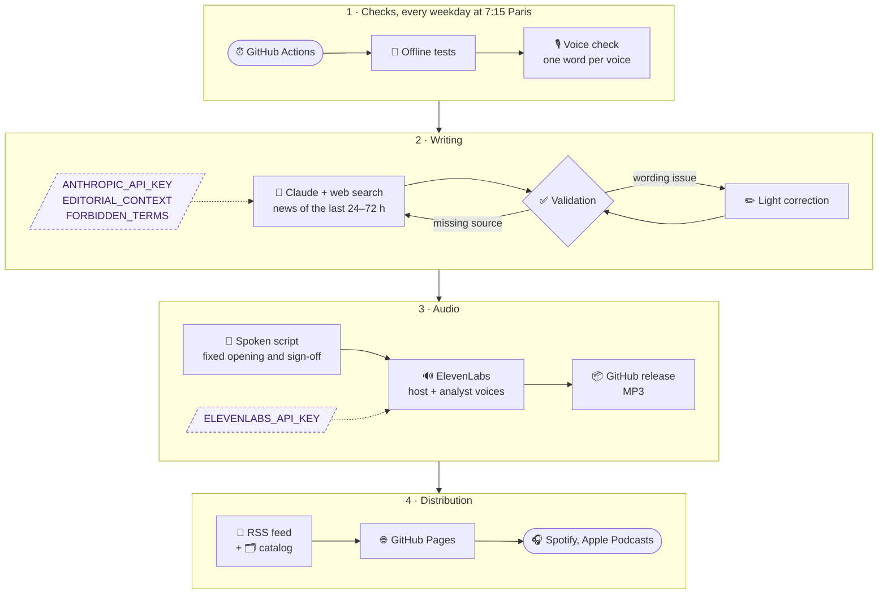
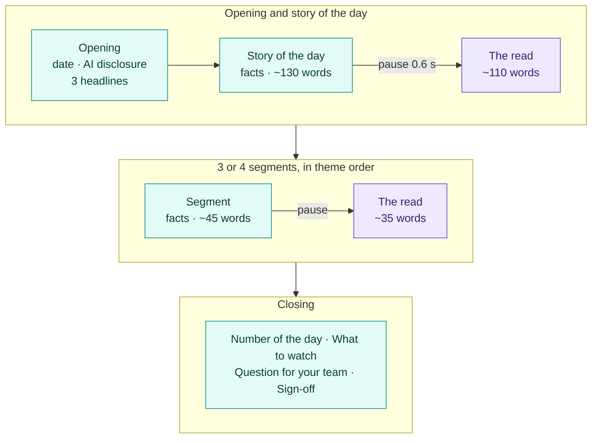
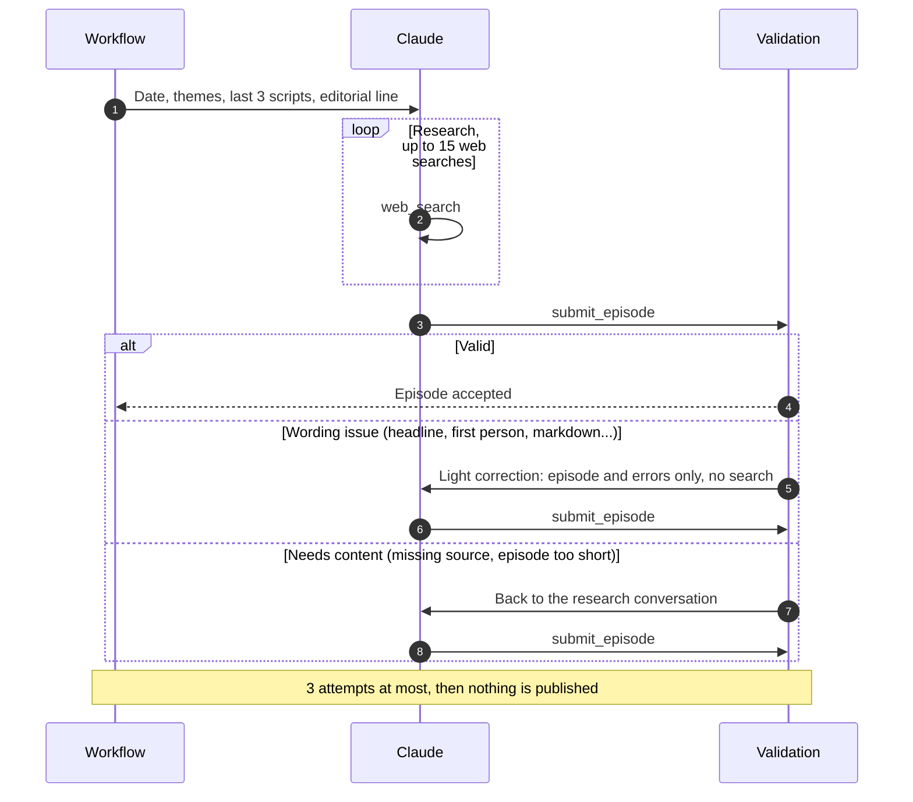

<p align="center">
  
</p>

# Signal in the AI Fog

A daily AI news podcast in English, fully generated and published automatically.

Every weekday morning, an episode of about six minutes covers enterprise AI in production: models and vendors, European sovereignty, LLMOps and MLOps platforms, quality and evaluation, regulation, retail and agents. The script is written by Claude from a web search, then read by two ElevenLabs voices. Episodes are distributed through an RSS feed that Spotify and other podcast platforms pick up automatically, and listed on a [catalog site](https://gwendalyviquel.github.io/signal-in-the-ai-fog/).

<p align="center">
  <a href="https://gwendalyviquel.github.io/signal-in-the-ai-fog/">
    
  </a>
</p>

## How it works



A GitHub Action runs four steps:

1. **Writing**: the Claude API, with the web search tool, picks five or six news stories from the last 24 to 72 hours and submits the episode through a `submit_episode` tool, one field per part, following the editorial line in `prompts/system.md`. The three previous scripts are passed in for continuity from one day to the next and to avoid repetition. The code validates the episode (structure, theme order, sources, no markdown, no first person, no forbidden terms, length) and assembles the spoken script with a fixed opening, transitions and sign-off.
2. **Speech synthesis**: two ElevenLabs voices share the episode. The host voice reads the opening, the facts, the transitions and the sign-off; the analyst voice reads every read layer, so the listener hears where analysis begins. A short pause marks each change of voice. Texts are split into chunks, with the neighbouring chunks of the same voice as context to keep the delivery continuous.
3. **Hosting**: the MP3 is published as a GitHub *release* asset (`episode-YYYY-MM-DD`).
4. **Distribution**: `data/episodes.json` is updated, then the `docs/feed.xml` feed and the `docs/catalog.json` catalog are regenerated and deployed to GitHub Pages.

### Episode format

Every episode follows the same structure. Each story has two layers: the facts (what happened and its real status: announced, preview or available), read by the host, and a short read (what it means for a platform team or a retailer), read by the analyst and signposted so the listener hears where analysis begins.



<sub>🟩 host voice &nbsp; 🟪 analyst voice &nbsp; a short pause at each change of voice. On Mondays the episode covers the news since Friday and the week ahead; on Fridays the story of the day steps back to look at a trend from the week.</sub>

### Generation and corrections

The episode is submitted through a tool, so the JSON is always well formed. A wording problem is fixed in a light conversation (the episode and its errors only, much cheaper than replaying the research); anything that needs new content goes back to the research conversation, so a source is never invented.



### Run modes

Each mode runs part of the pipeline, from a one-word voice check to a full episode.

| Mode | Trigger | Claude | ElevenLabs | Release | RSS feed | Catalog site |
| --- | --- | :---: | :---: | :---: | :---: | :---: |
| Voice check | *Check voices* (manual, and on every change of `config.yaml`) | — | 🔸 one word per voice | — | — | — |
| Dry run | *Daily episode*, `dry_run` (default for manual runs) | ✅ | — | — | — | — |
| Preview | *Preview episode* (manual) | ✅ | — | — | — | 🔸 Preview card |
| Rehearsal | *Publication rehearsal* (manual) | — | 🔸 silence, or two sentences with `with_voice` | 🔸 test, deleted | 🔸 checked, not written | 🔸 checked, not written |
| Publish | *Daily episode* without `dry_run`, or the schedule | ✅ | ✅ | ✅ | ✅ | ✅ |

- **Voice check**: each configured voice reads `Hi.` (3 characters), independently, to prove the API accepts it; candidate voice IDs can be checked without changing the config. It also runs before every real publication, before Claude is called.
- **Dry run**: the script is downloadable from the `episode-script` artifact.
- **Preview**: the real script is published as a **Preview** card on the catalog site, with an audio placeholder. The RSS feed is never touched, so nothing reaches Spotify; a published episode later replaces its preview.
- **Rehearsal**: an MP3 is uploaded as a release, downloaded back from its public URL and checked in the feed and catalog, then the release is deleted. Nothing is published or committed. With `with_voice`, both voices read two short sentences (147 characters) and the sample is kept as an artifact.
- **Force** (`force` option): regenerates today's episode even if it already exists (or on a weekend), replacing the release.

The schedule (`cron` in UTC in the workflow) aims to have the episode ready before the morning commute, Monday to Friday.

## Repository contents

```
config.yaml                          podcast metadata, models, voice, themes covered
prompts/system.md                    editorial line, episode format, writing rules for the voice
podcast/main.py                      pipeline (entry point: python -m podcast.main)
podcast/generate.py                  script writing with the Claude API and web search
podcast/tts.py                       ElevenLabs speech synthesis
podcast/publish.py                   MP3 upload as a GitHub release (gh CLI)
podcast/feed.py                      RSS feed compatible with Spotify and Apple Podcasts
podcast/catalog.py                   data for the episode catalog site
podcast/rehearsal.py                 publication rehearsal
data/episodes.json                   history of published episodes (source of the RSS feed)
data/scripts/                        archived scripts, one Markdown file per day
data/previews.json, data/previews/   preview episodes (catalog only) and their scripts
docs/                                GitHub Pages site: catalog page, feed.xml, catalog.json, cover.jpg
tools/make_cover.py                  cover art generation (python tools/make_cover.py [output.jpg])
tools/screenshot_site.py             screenshot of the catalog site for this README
assets/                              images used by this README
.github/workflows/daily-episode.yml  daily workflow
.github/workflows/deploy-site.yml    site deployment when docs/ changes
.github/workflows/preview-episode.yml  script-only run published to the catalog site
.github/workflows/tests.yml          test suite on every push
.github/workflows/rehearsal.yml      publication rehearsal (silent audio, deleted afterwards)
.github/workflows/check-voices.yml   one-word check of every ElevenLabs voice
tests/                               offline test suite (pytest)
TESTING.md                           test suite and journal of real runs
```

### Configuration

- `config.yaml` holds everything editorial or tunable: title, description, language, Claude model, target length, ElevenLabs voice and model, and the list of themes with their scope. Themes can be changed at any time; they are used in segment order.
- `prompts/system.md` defines the tone, the audience, the source-checking rules and the expected output format (`<title>`, `<summary>`, `<script>`, `<sources>`).
- The `ANTHROPIC_API_KEY` and `ELEVENLABS_API_KEY` keys are stored as GitHub Actions secrets. No secret is committed.
- The optional `FORBIDDEN_TERMS` secret is a comma-separated list of names that must never be spoken; an episode containing one is rejected.

## Episode catalog

The GitHub Pages home page (`docs/index.html`) lists every episode as a card: cover image, status (Published or Preview), date, duration, title, summary, headlines, themes, audio player (or a placeholder for previews), Spotify link, script and sources. Episodes can be searched (titles, summaries, scripts) and filtered by theme, and each one has its own link (`#YYYY-MM-DD`). Every card and the header have a "Listen on Spotify" button: it opens `podcast.spotify_url` from `config.yaml` once set, and a Spotify search for the podcast until then.

The site is published at https://gwendalyviquel.github.io/signal-in-the-ai-fog/ by `.github/workflows/deploy-site.yml` whenever `docs/` changes, and by the daily workflow after each episode. Hosting is free (GitHub Pages for the site and feed, GitHub releases for the audio).

## Tests

```
pip install -r requirements.txt -r requirements-dev.txt
python -m playwright install chromium   # for the catalog site tests
python -m pytest
```

The suite runs offline: Claude, ElevenLabs and `gh` are replaced by fakes, and the pipeline runs on a temporary copy of the data. It covers episode validation, the generation loop (tool submission, correction rounds, truncated responses), script assembly, speech chunking and retries, the RSS feed, the catalog, every run mode end to end, the cover art (platform specs, every word drawn, even without the DejaVu font), the catalog page in a headless browser (cards, Spotify button, search, filters, stats, deep links, HTML injection, mobile layout), the consistency between the prompt and the checks (an episode written exactly to the prompt must pass), the workflows (triggers, concurrency, dry-run guards), and repository hygiene (secrets wired into workflows, private files ignored, no forbidden term in tracked files when `FORBIDDEN_TERMS` is set). Every bug met in a real run gets a regression test.

[TESTING.md](TESTING.md) details the suite and keeps a journal of every real run, successful or not, with what each one taught us.

Tests run on every push (`.github/workflows/tests.yml`) and before every generation in the daily and preview workflows, so a broken commit never produces an episode.

## Costs and safeguards

- An episode is about 6,000 to 7,000 characters, which is as many ElevenLabs credits with a standard model, for 20 to 23 episodes a month.
- ElevenLabs is never called in a dry run.
- An episode that is already published is not regenerated, unless `force` is used.
- No episode is produced on weekends.

## Transparency

The opening of each episode and its description state that the content is written and read by AI, in line with the AI Act's labelling obligations for AI-generated content. Each episode's sources are listed in its description.
