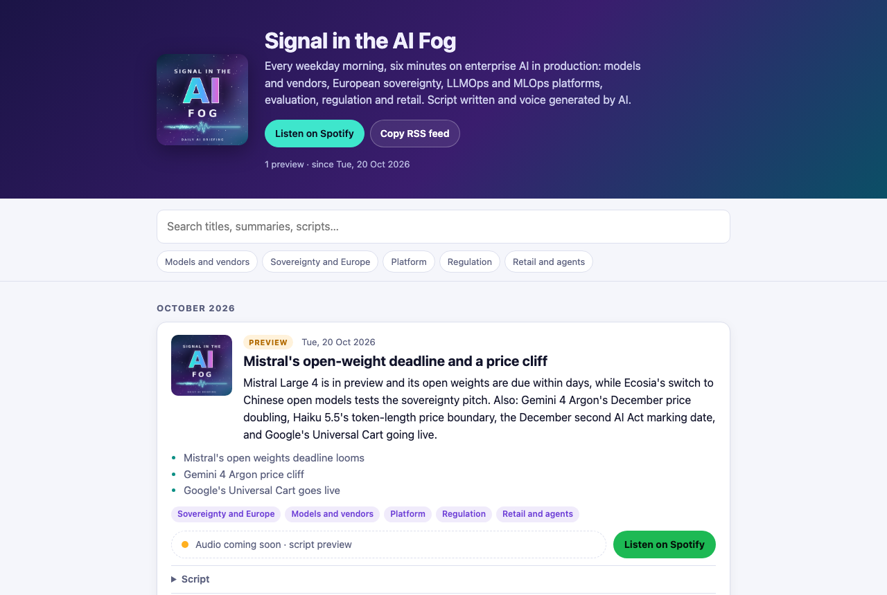
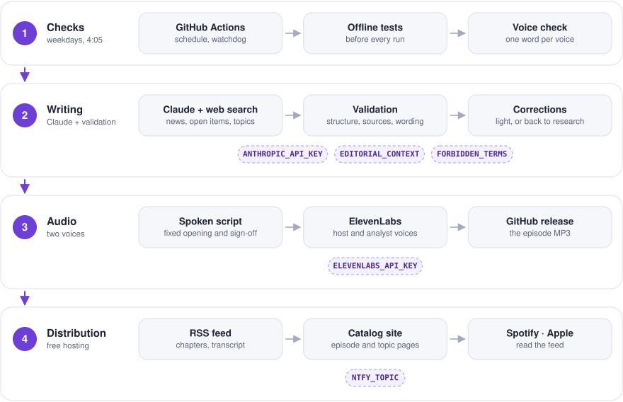
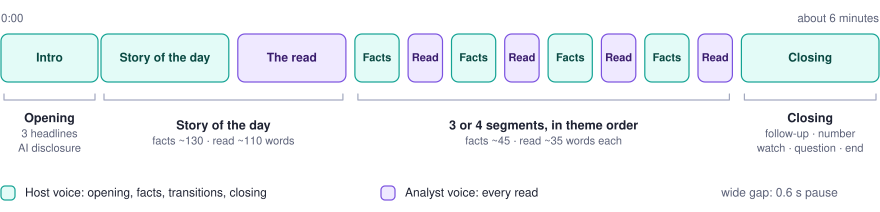
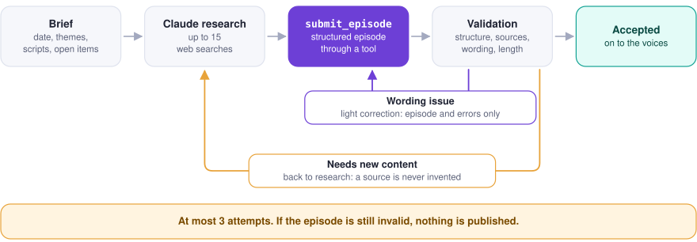
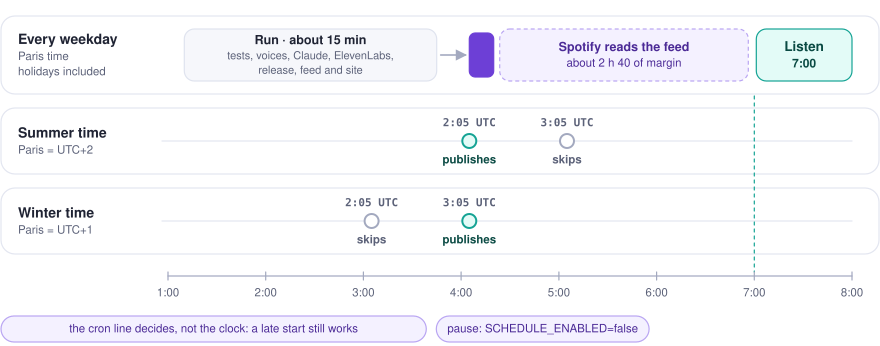
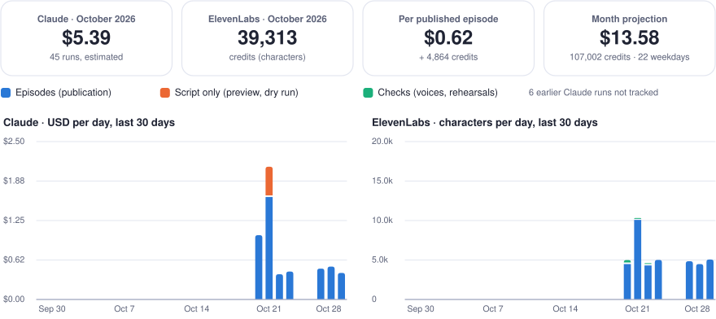

<p align="center">
  
</p>

# Signal in the AI Fog

A daily AI news podcast in English, fully generated and published automatically, and the **podcast engine** behind it: the same code runs other shows, each with its own editorial line, language, cadence, voices, feed and site (see [Shows](#shows)).

Every weekday morning, an episode of about six minutes covers enterprise AI in production: models and vendors, European sovereignty, LLMOps and MLOps platforms, quality and evaluation, regulation, retail and agents. The script is written by Claude from a web search, then read by two ElevenLabs voices. Episodes are distributed through an RSS feed that Spotify and other podcast platforms pick up automatically, and listed on a [catalog site](https://gwendalyviquel.github.io/signal-in-the-ai-fog/).

<p align="center">
  <a href="https://gwendalyviquel.github.io/signal-in-the-ai-fog/">
    
  </a>
</p>

## How it works

<p align="center">
  <picture>
    <source media="(prefers-color-scheme: dark)" srcset="assets/diagram-pipeline-dark.svg">
    
  </picture>
</p>

A GitHub Action runs four steps:

1. **Writing**: the Claude API, with the web search tool, picks five or six news stories from the last 24 to 72 hours and submits the episode through a `submit_episode` tool, one field per part, following the show's editorial line (`shows/<slug>/prompt.md`). The request also carries the three previous scripts (continuity, no repetition), the open items of the last What to watch (for a follow-up), the topics already used (so their spelling stays the same) and the listener suggestions the owner accepted. Everything Claude reads, web pages and suggestions alike, is data, never instructions. The code validates the episode (structure, theme order, sources, reliability labels, topics, no markdown, no first person, no forbidden terms, length), applies the source rules (primary sources preferred, content aggregators refused, a *confirmed* story cites a primary source), then **fact-checks** it: the code fetches each story's sources and Claude Haiku 5.5 checks every figure, date, name and status of the facts against them. A doubt goes back to a light correction, which may never add a source. The code then assembles the spoken script with a fixed opening, transitions and sign-off, and the corrections waiting to be read.
2. **Speech synthesis**: two ElevenLabs voices share the episode. The host voice reads the opening, the facts, the transitions and the sign-off; the analyst voice reads every read layer, so the listener hears where analysis begins. A short pause marks each change of voice. Texts are split into chunks, with the neighbouring chunks of the same voice as context to keep the delivery continuous. The start and end of every chunk are recorded, which places the chapters and the timed transcript.
3. **Hosting**: the MP3 is published as a GitHub *release* asset (`episode-YYYY-MM-DD`).
4. **Distribution**: the show's `data/episodes.json` is updated, then the `docs/feed.xml` feed (with chapters and transcript), the `docs/catalog.json` catalog, the episode and topic pages are regenerated and deployed to GitHub Pages. A phone notification says the episode is out, or that the run failed.

### Episode format

Every episode follows the same structure. Each story has two layers: the facts (what happened and its real status: announced, preview or available), read by the host, and a short read (what it means for a platform team or a retailer), read by the analyst and signposted so the listener hears where analysis begins.

<p align="center">
  <picture>
    <source media="(prefers-color-scheme: dark)" srcset="assets/diagram-episode-dark.svg">
    
  </picture>
</p>

On Mondays the episode covers the news since Friday and the week ahead; on Fridays the story of the day steps back to look at a trend from the week.

- **Follow-up** (optional): when an item from a previous What to watch moved forward (a vote happened, a model shipped), about 40 words on what was expected and what happened, with its source, before the number of the day. Never invented: no follow-up when nothing moved.
- **Reliability label** for every story, shown on its page: *confirmed* (the company, authority or a primary source, which the story must cite), *reported* (credible press, the facts say who reports it) or *unconfirmed* (a rumour or a single weak source, said plainly, and rare). Every source says whether it is **primary** (the organisation's own announcement, documentation, pricing page, filing, regulation text or paper), and its page marks it.
- **Corrections**: when an episode got something wrong, the next one reads the correction, as written, before the number of the day (see Corrections).
- **Topics**: one to three per story, the canonical names of the companies, products, laws or subjects ("Mistral", "EU AI Act"). Each topic has its own page on the site.

### Generation and corrections

The episode is submitted through a tool, so the JSON is always well formed. A wording problem is fixed in a light conversation (the episode and its errors only, much cheaper than replaying the research); anything that needs new content goes back to the research conversation, so a source is never invented.

<p align="center">
  <picture>
    <source media="(prefers-color-scheme: dark)" srcset="assets/diagram-generation-dark.svg">
    
  </picture>
</p>

### Run modes

Each mode runs part of the pipeline, from a one-word voice check to a full episode.

| Mode | Trigger | Claude | ElevenLabs | Release | RSS feed | Catalog site |
| --- | --- | :---: | :---: | :---: | :---: | :---: |
| Voice check | *Check voices* (manual, and on every change of a `show.yaml`) | — | 🔸 one word per voice | — | — | — |
| Dry run | *Daily episode*, `dry_run` (default for manual runs) | ✅ | — | — | — | — |
| Preview | *Preview episode* (manual) | ✅ | — | — | — | 🔸 Preview card |
| Rehearsal | *Publication rehearsal* (manual) | — | 🔸 silence, or two sentences with `with_voice` | 🔸 test, deleted | 🔸 checked, not written | 🔸 checked, not written |
| Publish | *Daily episode* without `dry_run`, or the schedule | ✅ | ✅ | ✅ | ✅ | ✅ |
| Watchdog | *Watchdog*, 5:11 and 6:41 Paris (and by hand) | only through the catch-up it starts | — | — | — | — |
| Offline rehearsal | `python tools/offline_rehearsal.py` (local) | 🔸 fixture | 🔸 silence | — | 🔸 on a copy | 🔸 on a copy |
| Correction | *Add a correction* (manual) | — | — | — | ✅ description | ✅ pages |

- **Voice check**: each configured voice reads `Hi.` (3 characters), independently, to prove the API accepts it; candidate voice IDs can be checked without changing the config. It also runs before every real publication, before Claude is called.
- **Dry run**: the script is downloadable from the `episode-script` artifact.
- **Preview**: the real script is published as a **Preview** card on the catalog site, with an audio placeholder. The RSS feed is never touched, so nothing reaches Spotify; a published episode later replaces its preview.
- **Rehearsal**: an MP3 is uploaded as a release, downloaded back from its public URL and checked in the feed and catalog, then the release is deleted. Nothing is published or committed. With `with_voice`, both voices read two short sentences (147 characters) and the sample is kept as an artifact.
- **Catch-up** (`episode_date` option of *Daily episode*): generates a past weekday's episode with that day's news cutoff (4:05 Paris) and only the scripts aired before it; it takes its date in the feed and its description says it is a catch-up. An episode or a release that already exists for that date stops the run before any cost, and stories shared with neighbouring episodes are reported.
- **Force** (`force` option): regenerates today's episode even if it already exists (or on a weekend), replacing the release.
- **Watchdog**: if today's episode is not out at 5:11, it starts the daily run as scheduled (real publication, news cutoff at 4:05) and notifies the phone; at 6:41 it checks again. It waits for a run still going, and stops retrying after two failed runs in a day, since each one pays Claude.
- **Correction**: see Corrections below. Free: no Claude, no ElevenLabs.
- **Offline rehearsal**: a whole publication on a copy of the repository, free: the real pipeline with Claude answering a fixture (the real script of October 21, with labels, topics and an invented follow-up), ElevenLabs returning silence as long as the text, and no `gh`. Its fact-check raises one doubt so the light correction and the second check run, and a waiting correction is read. It prints the chapters and writes a complete site to `build/rehearsal/docs`, to look at before a change reaches a real episode. A test runs it on every push.

### Schedule

<p align="center">
  <picture>
    <source media="(prefers-color-scheme: dark)" srcset="assets/diagram-schedule-dark.svg">
    
  </picture>
</p>

The daily workflow makes **attempts every 15 minutes on weekday mornings, public holidays included**, off the top of the hour (one cron line, `7,22,37,52 2-5 * * 1-5` in UTC, covers both seasons). The first attempt at **4:05 Paris time** (`generation.publish_at`) or later publishes; it is online about 5 minutes later, which leaves Spotify close to three hours before a 7:00 listen. The next attempts find the episode out and stop at once, at no cost; attempts before 4:05 (winter mornings) do nothing. An attempt GitHub starts hours late still publishes the day's episode, with the news cutoff at 4:05. After two failed attempts in a day, the next ones stop, since each paid Claude. Learning of October 21 and 22: with a single run at 4:05, GitHub dropped the morning's run or started it five hours late. Scheduled runs only start once the `SCHEDULE_ENABLED` repository variable is `true`:

```
gh variable set SCHEDULE_ENABLED --body true    # --body false to pause
```

**Several shows.** A scheduled attempt (GitHub or Cloudflare) runs every show in `shows/`, one after the other, and each one publishes only on its own days (`generation.cadence`: `weekdays`, or `weekly:<day>` for a weekly show), at its own `publish_at`. A manual run serves the show named in its `show` input (default: `signal-in-the-ai-fog`). The two-failure cap counts each show's failed attempts in its own cost ledger. Each show's private context is the secret named by `podcast.context_secret` (default `EDITORIAL_CONTEXT_<SLUG>`).

**On time, with Cloudflare.** GitHub's schedules are best effort, so a free Cloudflare Worker (`scheduler/`, Cron Triggers) starts the daily workflow at **4:05 Paris time**, then at 4:35 and 5:05 (and 5:35, 6:05 in summer), through GitHub's `workflow_dispatch` API, as the *Run workflow* button does. It runs as a scheduled attempt (`scheduled` input): the same guards decide, so a second start finds the episode out and stops at once. Its only secret is a GitHub token limited to this repository with *Actions: read and write*, stored encrypted in Cloudflare; the worker has no public URL. The GitHub attempts above stay as a backup.

A *Watchdog* workflow checks at **5:11 and 6:41 Paris time** that today's episode is out, and starts the catch-up if not (see Run modes): a second, independent chance. If GitHub drops every scheduled run of a morning, as on October 22, the phone notification of a missing episode is missing too: when no "Episode out" has arrived by about 5:00, start the run by hand (`gh workflow run daily-episode.yml -f dry_run=false -f as_scheduled=true`).

**Phone notifications** use [ntfy](https://ntfy.sh): install the ntfy app, subscribe to a hard-to-guess topic name, and store that name as the `NTFY_TOPIC` secret. The daily run notifies when an episode is out (with its page) or when it fails, and the watchdog when it starts a catch-up, waits for a late run or gives up. Without the secret, nothing is sent and nothing fails. To check the secret, run *Watchdog* by hand with `test_notification`: it only sends a test.

A *Check Spotify* workflow runs every 15 minutes on weekday mornings (and by hand): it reads Spotify's public embed page of the show, compares its latest episode with ours, and records in `data/spotify.json` when each episode was first seen live and how many minutes after publication, to confirm the margin before 7:00.

## Shows

| Show | Language | Cadence | Status |
| --- | --- | --- | --- |
| [Signal in the AI Fog](https://gwendalyviquel.github.io/signal-in-the-ai-fog/) (`shows/signal-in-the-ai-fog`) | English | every weekday | live |
| HR news (`shows/hr-news-fr`) | French | weekly, Monday | in preparation: voices to choose |
| Accounting news (`shows/accounting-news-fr`) | French | weekly, Monday | in preparation: voices to choose |

### Add a show

1. **Folder**: `shows/<slug>/show.yaml` (copy an existing one) and `prompt.md`. In `show.yaml`: title, `tagline` (spoken in the opening), description, `language` (`en` or `fr`: a locale in `engine/locales/`), `site_path` (the show's folder in the site, usually its slug), `release_prefix` (its releases and GUIDs, never changed after the first episode), `context_secret`, `cadence` (`weekdays` or `weekly:<day>`), `publish_at`, `target_words` and, for a longer format, `lengths`; themes, `sources.avoid`, and `scheduled: false` while it is prepared. HTML comments in `prompt.md` are notes for maintainers, never sent to Claude.
2. **Cover**: `podcast.cover_kicker` and `podcast.cover_palette` (three colours), then `python tools/make_cover.py --show <slug>`.
3. **Voices**: candidate ElevenLabs voice IDs checked with *Check voices* (`voice_ids`, a few characters each); once written in the show's `tts.voices` (the show is still unscheduled), *Publication rehearsal* with `with_voice` and `show` reads two short sentences with them (about 150 characters), to listen to before keeping them.
4. **Rehearse for free**: a fixture `tests/fixtures/episode-<slug>.json` in the show's language, then `python tools/offline_rehearsal.py build/rehearsal <slug>`: the whole publication on a copy, site in `build/rehearsal/docs/<site_path>/`.
5. **Preview** (Claude only, about $0.50): *Preview episode* with `show`, after the day's episode if any (`force`). Read it: labels, sources, topics, fact-check doubts in the run summary.
6. **Go live**: the private context in the `EDITORIAL_CONTEXT_<SLUG>` secret if any, `scheduled: true`, then the first episode on the show's next day; submit its feed (`docs/<site_path>/feed.xml`) to Spotify once, and set `spotify_url`.

A new language is a new `engine/locales/<code>.yaml` with the same keys as `en.yaml` (a test checks): spoken texts, chapters, feed labels, dates, the first person to avoid, the site's interface.

## Repository contents

```
.
├── engine/                         the podcast engine, shared by every show: python -m engine.main
│   ├── show.py                     a show: its config, its files, its site folder (SHOW=<slug>)
│   ├── locale.py                   a show's language and cadence: fixed spoken texts, feed, dates
│   ├── locales/                    en.yaml, fr.yaml
│   ├── templates/                  catalog.html, every show's catalog page
│   ├── main.py                     run modes, guards, catch-ups
│   ├── generate.py                 script writing with Claude and web search, validation
│   ├── context.py                  open items, known topics, accepted listener suggestions
│   ├── factcheck.py                every claim of the facts against its own sources (Haiku)
│   ├── corrections.py              public corrections, read in the next episode
│   ├── tts.py                      ElevenLabs speech, two voices, voice check, chunk timings
│   ├── chapters.py                 chapters and timed transcript (WebVTT)
│   ├── publish.py                  MP3 as a GitHub release (gh CLI)
│   ├── feed.py                     RSS feed for Spotify and Apple Podcasts
│   ├── catalog.py                  data of the catalog site
│   ├── site.py                     episode and topic pages, sitemap
│   ├── notify.py                   phone notifications (ntfy)
│   ├── watchdog.py                 morning check, catch-up if the episode is missing
│   ├── costs.py                    cost tracking: Claude tokens, ElevenLabs characters
│   ├── finops.py                   FinOps dashboard, rebuilt after every run
│   ├── stats.py                    download counts of the episodes
│   ├── spotify.py                  is the latest episode live on Spotify
│   ├── rehearsal.py                publication rehearsal
│   └── drawing.py                  drawing helpers shared by the diagrams and the dashboard
├── shows/
│   ├── signal-in-the-ai-fog/       one folder per show: the first one, in English, daily
│   │   ├── show.yaml               podcast, models, voices, themes, schedule, sources, prices
│   │   ├── prompt.md               editorial line, episode format, writing rules for the voice
│   │   ├── data/                   episodes, scripts, previews, costs, stats, spotify.json
│   │   ├── COSTS.md                costs report, and its FinOps dashboard (finops-dashboard-*.svg)
│   │   └── STATS.md                downloads report
│   ├── hr-news-fr/                 HR news, in French, weekly (in preparation)
│   └── accounting-news-fr/         accounting news, in French, weekly (in preparation)
├── docs/                           GitHub Pages: the first show at the root, the next ones in docs/<slug>/
│   ├── episodes/                   one page per episode, with its transcript (.vtt) and chapters (.json)
│   ├── topics/                     one page per topic, and the list of topics
│   ├── corrections.html            every correction
│   ├── hr-news-fr/                 the site of another show: same files, in its folder
│   ├── shows.html                  every show of the engine
│   ├── i18n.js                     the EN | FR switch, shared by every page
│   └── i18n.json                   interface texts of every language (generated)
├── assets/                         images and diagrams of the README, light and dark
├── tools/
│   ├── make_cover.py               cover art
│   ├── make_diagrams.py            diagrams of the README
│   ├── offline_rehearsal.py        a whole publication on a copy, at no cost
│   ├── api_smoke.py                the real API accepts what the code sends (a few cents)
│   └── screenshot_site.py          screenshot of the catalog site
├── tests/                          offline test suite (pytest); fixtures/ holds a real episode
├── scheduler/                      Cloudflare Worker that starts the daily episode on time
├── .github/ISSUE_TEMPLATE/         feedback and topic suggestion forms
├── .github/workflows/
│   ├── daily-episode.yml           the daily episode: schedule, dry run, catch-up
│   ├── preview-episode.yml         script only, published to the catalog
│   ├── check-voices.yml            one word per ElevenLabs voice
│   ├── rehearsal.yml               publication rehearsal, release deleted afterwards
│   ├── check-spotify.yml           episode live on Spotify, and after how long
│   ├── stats.yml                   daily download counts
│   ├── watchdog.yml                5:11 and 6:41 check, catch-up if the episode is missing
│   ├── correction.yml              add a correction to a published episode
│   ├── api-smoke.yml               the real API accepts what the code sends (a few cents)
│   ├── deploy-site.yml             site deployment when docs/ changes
│   ├── dependabot-merge.yml        Dependabot security updates merged once tested
│   └── tests.yml                   test suite on every push
├── TESTING.md                      test suite and journal of real runs
└── RUNTIME.md                      simulated connectors, and the actions to verify them for real
```

### Configuration

- Each show lives in `shows/<slug>/`; `engine/show.py` loads it, and every command takes the show from the `SHOW` environment variable (default: `signal-in-the-ai-fog`). `podcast.site_path` places its site and feed in `docs/` (empty for this first show, whose feed URL must never move) and `podcast.release_prefix` names its releases and GUIDs.
- `show.yaml` holds everything editorial or tunable: title, description, language, Claude model, target length, ElevenLabs voice and model, and the list of themes with their scope. Themes can be changed at any time; they are used in segment order.
- `prompt.md` defines the tone, the audience, the source-checking rules, the reliability labels, topics and follow-ups, and the fields of the `submit_episode` tool.
- The `ANTHROPIC_API_KEY` and `ELEVENLABS_API_KEY` keys are stored as GitHub Actions secrets. No secret is committed.
- The optional `FORBIDDEN_TERMS` secret is a comma-separated list of names that must never be spoken or published (topics included); an episode containing one is rejected.
- The optional `NTFY_TOPIC` secret is the ntfy topic of the phone notifications.
- `sources.avoid` lists the sites never cited (content aggregators that rewrite other outlets' news); `factcheck` sets the fact-check model and how much of each page it reads.

## Episode catalog

Every show has its catalog: the first show at the site's root (`docs/index.html`), the others in their folder (`docs/<slug>/index.html`), all generated from one template (`engine/templates/catalog.html`). [`docs/shows.html`](https://gwendalyviquel.github.io/signal-in-the-ai-fog/shows.html) lists every show, with its cadence and language.

**Two languages, with a switch.** Each show's pages are written in its language (English or French), and an **EN | FR** switch in the header translates the interface of every page: menus, buttons, headings, labels, dates. The choice is remembered in the browser from page to page and from show to show; episodes always stay in the language they were made in. The interface texts live in `engine/locales/*.yaml` (`site` section), served to the browser as `docs/i18n.json` and applied by `docs/i18n.js`; without JavaScript, a page reads in its show's language.

The catalog lists every episode as a card: cover image, status (Published or Preview), date, duration, title, summary, headlines, themes, audio player (or a placeholder for previews), Spotify link, script and sources. Episodes can be searched (titles, summaries, scripts) and filtered by theme, and each one has its own link (`#YYYY-MM-DD`). Every card and the header have a "Listen on Spotify" button: it opens `podcast.spotify_url` from the `show.yaml` once set, and a Spotify search for the podcast until then.

Each episode also has **its own page** (`docs/episodes/YYYY-MM-DD.html`), linked from its card and from its description in podcast apps: summary, player, chapters that jump the player to that moment, then every story with its reliability label, its facts and its read, its topics and its sources, the follow-up, the number of the day, What to watch and the question. The first three episodes (October 19 to 21) were rebuilt from their archived scripts, with labels and topics added after publication, as their pages say; a test checks that each one reassembles word for word into the script that aired. Pages carry a canonical link, Open Graph tags and schema.org `PodcastEpisode` data, and `docs/sitemap.xml` lists them all, so search engines can index every episode.

**Topic pages** (`docs/topics/`) gather everything said about a company, product, law or subject, as a timeline, newest first, with the label of each story; `docs/topics/index.html` lists every topic by number of mentions.

Pages are generated by `engine/site.py` after every preview and publication; `python -m engine.site` rebuilds the catalog and every page from the committed data. Every text is escaped, since titles, topics and sources come from the web.

The site is published at https://gwendalyviquel.github.io/signal-in-the-ai-fog/ by `.github/workflows/deploy-site.yml` whenever `docs/` changes, and by the daily workflow after each episode. Hosting is free (GitHub Pages for the site and feed, GitHub releases for the audio).

## Corrections

When an episode got something wrong, run *Add a correction* (Actions tab, or `gh workflow run correction.yml -f episode_date=YYYY-MM-DD -f text="..."`). The text is read aloud as written in the next episode, so it follows the rules of the voice: no first person, no markdown, 8 to 70 words, for example *"The episode of October twentieth said the launch sale ran for two weeks. Mistral set it at one week."* The correction then appears at once on the episode's page, in its description in podcast apps, and on the [corrections page](https://gwendalyviquel.github.io/signal-in-the-ai-fog/corrections.html); its page says which episode read it. A catch-up episode never reads a correction, since it would be published after its own date.

## Listener feedback

Every episode page has two buttons that open a GitHub issue form: **Give feedback** (the episode date filled in, useful or not, what worked) and **Suggest a topic**. A free GitHub account is needed, and the forms say plainly that issues are public.

Suggestions reach Claude only once the owner adds the **accepted** label, which only a maintainer can do: the daily run then passes the open, accepted suggestions to Claude (at most ten, 300 characters each) as data, to cover when there is real news about them. Close a suggestion to stop it. An accepted issue can still be edited by its author afterwards, so the prompt treats it, like every web page, as data and never as instructions, and the usual checks (forbidden terms, sources, format) still apply to the episode.

## Tests

<p align="center">
  <picture>
    <source media="(prefers-color-scheme: dark)" srcset="assets/diagram-testplan-dark.svg">
    
  </picture>
</p>

```
pip install -r requirements.txt -r requirements-dev.txt
python -m playwright install chromium   # for the catalog site tests
python -m pytest
python tools/offline_rehearsal.py       # a whole publication on a copy, free; site in build/rehearsal/docs
```

The suite runs offline: Claude, ElevenLabs and `gh` are replaced by fakes, and the pipeline runs on a temporary copy of the data. It covers episode validation, the generation loop (tool submission, correction rounds, truncated responses), script assembly, speech chunking and retries, the RSS feed, the catalog, every run mode end to end, the cover art (platform specs, every word drawn, even without the DejaVu font), the catalog page in a headless browser (cards, Spotify button, search, filters, stats, deep links, HTML injection, mobile layout), the consistency between the prompt and the checks (an episode written exactly to the prompt must pass), the workflows (triggers, concurrency, dry-run guards), the chapters and timed transcript, the episode and topic pages (escaping, labels, feedback links, sitemap, stale pages), the watchdog and the notifications, the offline rehearsal end to end, and repository hygiene (secrets wired into workflows, private files ignored, no forbidden term in tracked files when `FORBIDDEN_TERMS` is set, scheduled workflows last changed by a commit linked to a GitHub account). Every bug met in a real run gets a regression test.

[RUNTIME.md](RUNTIME.md) lists every outside service the suite only simulates, whether it ran for real, and the actions that verify it, in order and with their cost. [TESTING.md](TESTING.md) details the suite and keeps a journal of every real run, successful or not, with what each one taught us.

Tests run on every push (`.github/workflows/tests.yml`) and before every generation in the daily and preview workflows, so a broken commit never produces an episode.

## FinOps

<p align="center">
  <picture>
    <source media="(prefers-color-scheme: dark)" srcset="shows/signal-in-the-ai-fog/finops-dashboard-dark.svg">
    
  </picture>
</p>

Every run records what it consumed, failed runs and dry runs included: Claude tokens and web searches, with a dollar estimate from the prices in `show.yaml`, and ElevenLabs characters (its credits). The dashboard above and [COSTS.md](shows/signal-in-the-ai-fog/COSTS.md) are rebuilt and committed after each run, and each run's GitHub summary shows its own cost.

- **One episode** cost about **$1 of Claude** in the first runs (mostly the web search results it reads) and **5,000 ElevenLabs credits**; a month of weekdays, about **$20 and 110,000 credits**. Since October 22, the research conversation is cached (the history re-sent after a pause or a correction is billed at a tenth) and the web search filters its results before Claude reads them; the fact-check adds about one cent. The new cost per episode is to be measured on the first runs.
- **Before paying for anything**, the voice check (3 characters per voice) and the duplicate guards stop a run that would fail; wording corrections go to a light conversation without the research.
- **Never paid twice**: an episode already published is skipped, an orphan release stops the run, and nothing is published on weekends.
- **Free**: hosting (GitHub Pages and releases), the Spotify check, the download stats and the CI.
- **Audience**: downloads of each episode in [STATS.md](shows/signal-in-the-ai-fog/STATS.md) and on the catalog site; Spotify plays in Spotify for Creators.

## Transparency

The opening of each episode and its description state that the content is written and read by AI, in line with the AI Act's labelling obligations for AI-generated content. Each episode's sources are listed in its description.
