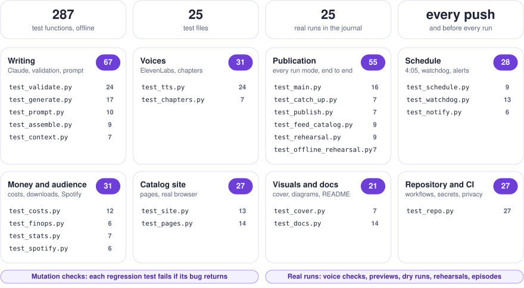

# Testing journal

How this project is tested, and a log of every real run, successful or not, with what it taught us. Each failure or surprise gets a fix and a regression test, so it cannot happen again silently.

## How testing works

Three layers, from cheapest to most realistic:

<p align="center">
  <picture>
    <source media="(prefers-color-scheme: dark)" srcset="assets/diagram-testing-dark.svg">
    
  </picture>
</p>

1. **Offline test suite** (`tests/`, pytest). Claude, ElevenLabs and `gh` are replaced by fakes; the pipeline runs on a temporary copy of the data; the catalog page runs in headless Chromium. Runs on every push (`tests.yml`) and before every generation, so a broken commit never produces an episode.
2. **Offline rehearsal** (`python tools/offline_rehearsal.py`, also run by the suite). A whole publication on a copy of the repository with the real pipeline: Claude answers with a fixture (the real script of October 21, with labels, topics and an invented follow-up), ElevenLabs returns silence as long as the text would last, `gh` is replaced. It catches what unit tests miss between the pieces (request, validation, timings, chapters, feed, pages) and writes a complete site to `build/rehearsal/docs` to look at in a browser. Free.
3. **Mutation checks**. To prove a test really protects against a bug, the bug is reintroduced in a scratch copy of the code and the suite must fail. Every regression test below was checked this way.
4. **Real runs on GitHub**, in increasing order of what they touch:
   - *Preview episode*: real script from Claude, published as a Preview card on the site; no audio, RSS feed untouched.
   - *Daily episode* with `dry_run`: real script, nothing published.
   - *Publication rehearsal*: real release upload and download, feed and catalog checked, release deleted; with `with_voice`, both ElevenLabs voices read two short sentences.

```
pip install -r requirements.txt -r requirements-dev.txt
python -m playwright install chromium   # for the catalog site tests
python -m pytest
python tools/offline_rehearsal.py       # then: python -m http.server --directory build/rehearsal/docs
```

## Test suite

<p align="center">
  <picture>
    <source media="(prefers-color-scheme: dark)" srcset="assets/diagram-testplan-dark.svg">
    
  </picture>
</p>

| File | Tests | What it protects |
| --- | --- | --- |
| `test_validate.py` | 30 | Episode validation: headlines, themes and their order, sources, unspeakable characters (with the offending extract), first person, forbidden terms in spoken and published text (topics included), lengths, reliability labels, topics, the optional follow-up and its source; source rules: avoided sites dropped or sent back to research, confirmed needs a primary source, every source says whether it is primary, episodes rebuilt after publication exempt; the agenda field optional, a bad date only warns |
| `test_generate.py` | 19 | The Claude loop: submission through the tool, light corrections versus corrections in the research conversation (no invented source), truncated responses, `pause_turn`, every tool call answered, workspace header, private context; research cached with the filtering web search; **no request forces the tool choice** (the fake API refuses it, as Claude Sonnet 5.5 does) |
| `test_assemble.py` | 9 | Spoken script: fixed opening with AI disclosure, order of parts, sign-off by weekday, headline punctuation, the read layer always on the analyst voice, the follow-up read by the host before the number of the day |
| `test_spotify.py` | 6 | Spotify check on the public embed page (same structure as the real one): show not available yet, previous episode still showing, first time live recorded once with the delay, show link from the config, checks cover the morning in both seasons |
| `test_stats.py` | 7 | Download stats: only episode MP3s counted, releases read safely across pages, one snapshot a day, STATS.md totals and last 7 days, catalog counts for published episodes only, daily workflow that redeploys the site |
| `test_tts.py` | 27 | ElevenLabs: chunking (long sentences split by words), request shape, voice settings, retries, one voice per part, context never crossing voices, pause in the same audio format as the voices, failures naming the voice, one-word voice check testing each voice independently, candidate IDs checked without changing the config, real duration kept when chunks are concatenated, start and end of every chunk (pauses included) for the chapters; the account's credits read from the subscription, unreadable credits never blocking, characters needed from the show's own episodes with a margin |
| `test_overview.py` | 5 | Reports across every show, costs and usage never mixed: money per show with projections (weekdays or a weekly day) and the shared ElevenLabs credits, cost per download; listening per show with last 7 days and new downloads per day, no money; reports written in shows/; every run rebuilds the costs of every show; a weekly show's projection |
| `test_finops.py` | 6 | FinOps dashboard: month figures and projection, daily spend by kind of run on Paris days (failed runs still cost), round axis maximum, no-episode state, both dashboards rebuilt on every record, committed dashboard matches the ledger; the projection of a weekly show over its own episode days (in test_overview.py) |
| `test_feed_catalog.py` | 9 | RSS feed (valid XML, escaping, enclosure, AI disclosure), Podcasting 2.0 transcript and chapters, chapter timestamps in the description only from three (Spotify), link to the episode page; catalog (previews replaced by published episodes, page, topics, chapters) |
| `test_main.py` | 21 | Every run mode end to end: dry run, preview, publication, force, weekend, failed speech keeps the preview and does not archive the script, voices checked before paying for the script; chapters, transcript, structured episode, pages and notification note written at publication; open items, known topics and suggestions in the request; no path of the pipeline left in the real repository during tests; pending corrections read and marked aired, never in a catch-up; too few ElevenLabs credits stop a run before paying anything (alert, counted as a failed attempt), unreadable credits let it go on |
| `test_publish.py` | 7 | `gh release` commands, public audio URL, Pages URL, download retries, Paris time |
| `test_rehearsal.py` | 9 | Rehearsal leaves nothing behind, release deleted even on failure, ElevenLabs key only for the voice check |
| `test_prompt.py` | 12 | Prompt and checks agree: an episode written exactly to the prompt passes, with or without a follow-up; labels and topic limits stated as checked; what Claude reads is data, never instructions; every placeholder filled, source and fact-check rules stated |
| `test_catch_up.py` | 7 | Catch-up episodes: that day's news cutoff, only the scripts aired before it, its place in the feed, announced as a catch-up; invalid dates stop before any cost; an episode is never published twice; an orphan release stops the run before any cost; overlaps with neighbouring episodes reported |
| `test_cover.py` | 9 | Cover meets Spotify and Apple specs, deterministic, every word drawn even without the DejaVu font; every show's cover meets the specs, a show cover is deterministic and draws its title |
| `test_site.py` | 17 | Catalog page in a real browser: cards, Spotify button, search, theme filter, stats, deep links, HTML injection, mobile, download counts, the EN | FR switch translating the interface and remembered, generated pages following it; the home page listing the shows and following the browser's language, its Home button back, past agenda items moved under their own heading |
| `test_docs.py` | 14 | README and TESTING.md: images and paths exist, light and dark diagrams, workflow names, committed diagrams match their generator, the pipeline diagram names exactly the secrets the workflow uses, the episode diagram matches the prompt, the schedule diagram matches the crons and the code, **every text fits its box and nothing leaves the drawing** (measured in Chromium), the site screenshot can be regenerated, the test plan covers every test file, the pipeline diagram shows the publication time |
| `test_schedule.py` | 10 | Attempts every 15 minutes: every weekday of 2026 and 2027 (both daylight saving changes, every holiday) has an attempt within 15 minutes after 4:05 Paris and two hours of further ones, none on weekends; attempts before 4:05 do nothing; an attempt started hours late still publishes; off the top of the hour; an early attempt, then one that publishes, then one that stops; two failed attempts stop the next ones; failures counted from GitHub, never blocking when it cannot answer; the site deployed only after a publication; failed attempts counted per show from its cost ledger |
| `test_costs.py` | 13 | Claude usage summed over every call (research pauses, corrections), kept when generation gives up; dollar estimate; prices tied to the model in use; ledger, COSTS.md and step summary; every mode records its spend, a run failing half-way still records what was billed, a refused voice is not counted; the news cutoff of scheduled runs; the fact-check priced at its own model and added to Claude |
| `test_repo.py` | 29 | Workflows (secrets, triggers, concurrency, dry-run guards, schedules owned by a GitHub account, Dependabot merged only once tested, voice check only gets the ElevenLabs key), private files ignored, no forbidden term in tracked files, config ready to publish, this journal in sync with the suite, costs committed after every run, failures included, phone notified after every real run, generation can read the accepted suggestions, issue forms match the site links, every scheduled workflow (changed or not) owned by a GitHub account, every push through tools/push_main.sh so files shared by every show never conflict |
| `test_context.py` | 7 | Request context: open items from the last What to watch before the episode (never later days), parser in step with the assembled script, topics most used first, only open and accepted suggestions, kept short, never blocking |
| `test_chapters.py` | 7 | Chapters in reading order (follow-up only when there is one), placed inside a chunk by its characters, Podcasting 2.0 JSON, Spotify timestamps, WebVTT with one cue per sentence covering every word |
| `test_pages.py` | 22 | Episode pages (stories, labels, layers, topics, sources, chapters that seek the player, feedback links pre-filled), fallback to the script, **everything from the web escaped** (JSON-LD included), topic timelines across episodes, slugs shared with the catalog page, stale pages removed, sitemap, committed pages up to date; every published episode has structured data that reassembles word for word into the script that aired, labels added afterwards say so; corrections escaped too, primary sources marked; a French show's pages in French reaching the shared files from its folder, every language's interface texts in i18n.json and committed up to date, the show list with the first show first; every page with a Home button and the first show's URLs kept (catalog at episodes.html), the agenda by date with the latest episode, the primary-source badge (Texte officiel in French), a new cover at a new address (cover.jpg?v=…) so no browser keeps the old one |
| `test_offline_rehearsal.py` | 13 | The offline rehearsal end to end: repository untouched, request content, chapters, transcript ending with the audio, feed tags, page, notification; a fact-check doubt corrected then checked again, research cached, a waiting correction read and shown; a weekly French show published on its day, in French, with its own release and site folder |
| `test_watchdog.py` | 15 | Every weekday of 2026 and 2027 checked at 5:00 and 6:30 exactly; episode out, run still going, catch-up started, retries stopped after two failures, weekend, winter crons; the catch-up is a real run with the scheduled cutoff; gh failures are loud; workflow permissions; a manual test notification that fails without the secret; several shows, each checked on its own cadence and started by name |
| `test_notify.py` | 6 | ntfy: nothing without the secret, JSON body, topic never printed, failures never break a run, urgent failure with the run link, quiet when nothing was published |
| `test_factcheck.py` | 15 | Fact-check: page text without scripts or navigation, unreadable pages and cookie walls fetched once and skipped, long pages cut, each part checked against its own sources only (reads never), doubts turned into correction requests with the evidence, unverifiable parts reported, a doubt fixed in a light correction then checked again, a doubt left after the last attempt reported not blocking, a light correction adding a source sent back to research, fact-check can be turned off; only claims the episode itself makes (not those of the source pages), and a fact its source contradicts gets one last correction |
| `test_dossier.py` | 6 | Two-step writing: a fact stays in the dossier only if its quote is on its page (case, apostrophes and spacing aside), an unreadable page keeps it as unread, a PDF is unread; research with web search then writing without it, the dossier saved and reused by a second run the same day; a source outside the dossier is refused; a dossier too thin after verification (too few facts or themes) sends the research back for the themes not covered, and the writing step gets the theme order |
| `test_language.py` | 4 | Language guard: a text's language told only when clear, a published part in another language than the show's is an error, a claim of the fact-check in another language (or too short to tell) is kept and checked, every step (research, writing, fact-check) told the episode's language |
| `test_corrections.py` | 7 | Corrections: attached to their episode and waiting to be read, spoken as written so the voice rules apply (length, first person, markdown, forbidden terms), only for published episodes, shown in the episode description, read by the host before the number of the day; the workflow uses no paid service, never runs beside an episode run, and passes its inputs through the environment |
| `test_scheduler.py` | 3 | Cloudflare scheduler: its Node tests (every weekday of 2026 and 2027 started at 4:05 Paris then retried, nothing on weekends or outside the morning, the request as a scheduled attempt, the test cron, a refusal from GitHub logged, no public endpoint), the inputs it sends exist in the workflows, no token in the repository |
| `test_locale.py` | 15 | Languages and cadences: every locale has the same keys and placeholders, the first show speaks exactly as before, a weekly French show speaks French (opening with the AI disclosure, transitions, sign-off), fixed French texts never use the first person, French first person (nous, notre, nos) refused while English still allows "the US", French chapters, the French What to watch parser, French feed labels and disclosure, French correction rules, cadences and episode days, dates independent of the system locale |
| `test_show.py` | 8 | Shows: the first show keeps its feed URL, releases, GUIDs and secret; a new show gets its own folder, releases, site path and secret; the show comes from SHOW then the default, an unknown one is named with the list; scheduled runs serve every show and manual runs the one named; the daily workflow runs shows one at a time without one stopping the others; manual workflows name their show; every show complete with its prompt filled and no maintainer note sent; shows in preparation never scheduled |

## Journal of real runs

| Date | Run | Result | What happened | What changed |
| --- | --- | --- | --- | --- |
| 2026-10-14 | [Daily episode, dry run](https://github.com/GwendalYviquel/signal-in-the-ai-fog/actions/runs/38538992425) | ❌ | Claude API: *This API key is not scoped to a workspace* (HTTP 400) on the first call | Optional `ANTHROPIC_WORKSPACE_ID` secret sent as the `anthropic-workspace-id` header. Test: `test_workspace_header` |
| 2026-10-20 | [Preview](https://github.com/GwendalYviquel/signal-in-the-ai-fog/actions/runs/39441708741) | ❌ | Same workspace error: the key was still the same | Workspace ID secret added |
| 2026-10-20 | [Preview](https://github.com/GwendalYviquel/signal-in-the-ai-fog/actions/runs/39454278765) | ✅ | First real script, passed on the first attempt. Review found: headlines too long with commas, a sector-specific angle, ambiguous prices, stacked "as of" updates, episode about 7 minutes, "0 episodes" on the site | Six editorial fixes in the prompt and checks |
| 2026-10-20 | [Preview](https://github.com/GwendalYviquel/signal-in-the-ai-fog/actions/runs/39455278989) | ❌ | Attempt 1: free-text JSON was malformed (unescaped quotes). Attempt 2: brackets in facts, and the error did not say which | Episode submitted through the `submit_episode` tool (well-formed JSON guaranteed); errors quote the offending extract. Tests: `test_episode_is_submitted_through_the_tool_not_as_text`, `test_unspeakable_characters_are_rejected_with_the_extract` |
| 2026-10-20 | [Preview](https://github.com/GwendalYviquel/signal-in-the-ai-fog/actions/runs/39455788344) | ✅ (3rd attempt) | Attempt 1 cut off at 8000 output tokens (missing fields); attempt 2 rejected for the comma in "1,000" in a headline | `max_tokens` 16000; truncation reported as such; numbers without separators in headlines. Tests: `test_max_tokens_leaves_room_for_the_episode`, `test_truncated_response_is_named_as_such`, `test_headline_numbers_must_be_spelled_out` |
| 2026-10-20 | [Preview](https://github.com/GwendalYviquel/signal-in-the-ai-fog/actions/runs/39457365897) | ✅ (3rd attempt) | Headlines rejected twice: a comma, then 9 words once a number was spelled out. Each correction replayed every search result, about 3x the cost | Light corrections (episode and errors only, no web search); fixes needing new content go back to research so no source is invented; headlines up to 10 words with the count in the error. Tests: `test_wording_errors_are_fixed_in_a_light_correction`, `test_missing_source_goes_back_to_the_research_conversation`, `test_failed_light_correction_resumes_the_research_conversation` |
| 2026-10-20 | [Preview](https://github.com/GwendalYviquel/signal-in-the-ai-fog/actions/runs/39458009029) | ✅ (1st attempt) | 873 words for a target of 880. Ran on the previous commit: the push had been rejected because the previous preview's bot commit was on `main` | Always `git pull --rebase` before pushing |
| 2026-10-20 | [Daily episode, dry run](https://github.com/GwendalYviquel/signal-in-the-ai-fog/actions/runs/39458351634) | ✅ (1st attempt) | Tests then generation in the daily workflow; publication steps skipped as expected | — |
| 2026-10-20 | [Publication rehearsal](https://github.com/GwendalYviquel/signal-in-the-ai-fog/actions/runs/39460386881) | ✅ | Silent MP3 uploaded as a release with `gh`, downloaded back from its public URL, feed and catalog valid, release and tag deleted | — |
| 2026-10-20 | [Rehearsal with voices](https://github.com/GwendalYviquel/signal-in-the-ai-fog/actions/runs/39488426877) | ❌ | ElevenLabs HTTP 400: *You need to be on the creator tier or above to use this voice* (first host voice). The key itself was accepted | Host voice changed |
| 2026-10-20 | [Rehearsal with voices](https://github.com/GwendalYviquel/signal-in-the-ai-fog/actions/runs/39489527571) | ❌ | ElevenLabs HTTP 402: *Free users cannot use library voices via the API*. First read as a failure of the new host voice; the ElevenLabs dashboard showed 62 credits used, exactly the host sentence: the host voice worked and the **analyst** voice failed. The log could not tell which voice had failed | Every ElevenLabs request is logged (role, voice, characters), and a failure names the voice and what was already billed. Test: `test_failure_names_the_voice_and_what_was_already_billed`. Open: an analyst voice usable on the free plan, or a paid plan |

| 2026-10-20 | [Rehearsal with voices](https://github.com/GwendalYviquel/signal-in-the-ai-fog/actions/runs/39490313144) | ❌ | New analyst voice: also a library voice, HTTP 402. Thanks to the new log, identified at once: `request 2, analyst voice`. But the host sentence was billed again (62 credits) just to reach the analyst voice | One-word voice check (`Hi.`, 3 characters per voice, each voice tested independently): *Check voices* workflow, run on every change of `config.yaml`, and before every real publication so a broken voice stops the run before Claude is paid. Tests: `test_voice_check_costs_one_word_per_voice_and_tests_each_independently`, `test_voices_are_checked_before_paying_for_the_script` |

| 2026-10-20 | [Check voices](https://github.com/GwendalYviquel/signal-in-the-ai-fog/actions/runs/39490668885) | ❌ (expected) | First one-word check: host voice ok, analyst voice HTTP 402. 3 characters billed instead of 62 | — |
| 2026-10-20 | [Check voices, candidate ID](https://github.com/GwendalYviquel/signal-in-the-ai-fog/actions/runs/39490818034) | ✅ | Candidate analyst voice checked without changing the config: ok, 3 characters | Adopted as the analyst voice |

| 2026-10-20 | [Check voices on push](https://github.com/GwendalYviquel/signal-in-the-ai-fog/actions) | ✅ | Automatic check after the analyst voice changed in `config.yaml`: both voices ok, 6 characters | — |
| 2026-10-20 | [Rehearsal with voices](https://github.com/GwendalYviquel/signal-in-the-ai-fog/actions/runs/39497411738) | ✅ but a bug found | Both voices, 147 characters, mono 44.1 kHz, release uploaded, downloaded and deleted. The log said 3.6 s for two sentences: the sample really lasts 9.7 s (370 frames). Each ElevenLabs response starts with an Info header giving its own duration; concatenated, the first one made tools and players read the first chunk's duration. A real episode would have shown a few seconds on Spotify and a wrong seek bar | Info headers and ID3 tags stripped from every chunk; durations computed by counting frames; the rehearsal fails if players would read a duration off by more than 0.5 s. Tests: `test_concatenated_chunks_keep_their_real_duration`, `test_header_frames_are_not_counted_as_sound`, `test_response_without_audio_fails_clearly` |

| 2026-10-20 | [**First real episode**](https://github.com/GwendalYviquel/signal-in-the-ai-fog/actions/runs/39503302732) | ✅ (1st attempt) | Run as if scheduled (`as_scheduled`, news cutoff 4:05 Paris). Voice check 6 characters, Claude in one attempt (one length warning), 9 ElevenLabs requests over both voices, release, feed and catalog deployed. 753 words, 5 min 12 s, and the feed announces 311 s: the duration fix holds on real audio. Cost: Claude 390,235 input tokens, 8,795 output, 15 searches, about $1.02; ElevenLabs 4,694 characters | Claude input is dominated by web search results: worth trying the newer web search tool with dynamic filtering |

| 2026-10-21 | [Catch-up of October 19](https://github.com/GwendalYviquel/signal-in-the-ai-fog/actions/runs/39504958372) | ✅ (1st attempt) | Monday episode generated two days later with the news cutoff of Monday 4:05. 857 words, 5 min 52 s, dated October 19 in the feed and announced as a catch-up. Overlap check: 3 sources shared with October 20 (Mistral Large 4, AI Act omnibus), expected since the 20th was made without the 19th. Leak check by hand: no date after the cutoff except an upcoming event in What to watch (October 24), nothing from the October 20 announcements. Cost: Claude about $0.83, ElevenLabs 5,357 characters | — |

| 2026-10-21 | [Check Spotify](https://github.com/GwendalYviquel/signal-in-the-ai-fog/actions/runs/39507777909) | ✅ | First check after the show was linked: "The show is not available on Spotify yet". The public show page also answers "Couldn't find that page": Spotify is still reviewing or indexing the new show | Scheduled checks every 15 minutes on weekday mornings will record when it goes live |

| 2026-10-21 | Daily episode, 4:05 schedule | ❌ | First morning with `SCHEDULE_ENABLED`: no run at all, not even skipped. No schedule of the repository had ever fired (*Check Spotify* every 15 minutes either). Every commit used `veille@example.invalid`, linked to no GitHub account, and GitHub does not fire a schedule last changed by such a commit. Episode caught up by hand with `as_scheduled` | Scheduled workflows re-pushed with the owner's GitHub noreply email. Test: `test_schedules_are_owned_by_a_github_account` |

| 2026-10-21 | [Check Spotify](https://github.com/GwendalYviquel/signal-in-the-ai-fog/actions/runs/39554406512) | ✅ | Run by hand: first episode found live, recorded 19 minutes after publication. Only an upper bound: no scheduled check had run, and the episode was already visible in the Spotify app before | Precise delays once the 15-minute schedule fires |

| 2026-10-21 | [Check Spotify, first scheduled run](https://github.com/GwendalYviquel/signal-in-the-ai-fog/actions/runs/39556859595) | ✅ | First schedule ever fired in the repository, about 40 minutes after the workflows were re-pushed with the GitHub noreply email (the 6:15 slot was still missed, the 6:30 one ran 10 minutes late): the email was the cause | Commits keep the noreply email (local git config) |

| 2026-10-21 | [Daily episode, late schedule](https://github.com/GwendalYviquel/signal-in-the-ai-fog/actions/runs/39569430324) | ✅ | First daily schedule after the fix: GitHub started the `5 3` line (winter time) at 8:27 UTC, 5 h 22 late. The code read the cron, not the clock: *the other side of daylight saving time today, nothing to do*. Had it been the right line, the already-published guard would have stopped it | Schedules can start hours late: the watchdog at 5:00 and 6:30 covers it, and the guards make a late run harmless |

| 2026-10-21 | [Watchdog, by hand](https://github.com/GwendalYviquel/signal-in-the-ai-fog/actions/runs/39572193341) | ✅ | First run on GitHub: permissions and `gh` work, *the episode of 2026-10-21 is out*, no catch-up started, nothing sent | — |

| 2026-10-21 | [Watchdog, test notification](https://github.com/GwendalYviquel/signal-in-the-ai-fog/actions/runs/39587951095) | ✅ | First test from GitHub reached the Mac app but not the phone, which was not set up yet; the second reached both | — |

| 2026-10-22 | [API smoke test](https://github.com/GwendalYviquel/signal-in-the-ai-fog/actions/runs/39677025724) | ❌ | First call of the new request shapes: the light correction (no forced tool choice) passed on the real API. The fact-check check then failed in the smoke script itself: a hand-built usage counter without `web_search_requests`. The fake answers carried no usage, so no test had seen it | The script uses the pipeline's counter; fake fact-check answers carry usage. Test: `test_the_smoke_test_counts_usage_like_the_pipeline` |

| 2026-10-22 | [API smoke test](https://github.com/GwendalYviquel/signal-in-the-ai-fog/actions/runs/39677269147) | ✅ | All three shapes accepted: light correction calls the tool unforced; Haiku 5.5 fact-check returns the JSON schema and matched *October sixth* with *Oct. 6*; `web_search_20260209` searched once and the cache wrote 7,889 tokens | — |

| 2026-10-21 | [Preview](https://github.com/GwendalYviquel/signal-in-the-ai-fog/actions/runs/39678017522) | ✅ (nothing done) | Run at 23:20 Paris: *the episode of 2026-10-21 is already published*, stopped before any cost | Rerun with `force` |

| 2026-10-21 | [Preview, forced](https://github.com/GwendalYviquel/signal-in-the-ai-fog/actions/runs/39678321471) | ✅ (3rd attempt) | First whole episode with caching, the filtering web search and the fact-check. **Claude $0.45 against $1.02**: 204,960 tokens read from the cache, 7,422 at full price. Attempt 1 too short (637 words), back to research. Fact-check (Haiku, 8 calls, under one cent): 36 claims, 8 doubts, fixed in a light correction, then 25 claims and 1 doubt left, reported. Three doubts were statements of absence (*no fine has been announced*), which no source can state. The story of the day cited two personal posts on dev.to | The checker skips statements of absence (`test_the_checker_skips_statements_of_absence`); dev.to added to `sources.avoid`; the preview of a date already published removed by hand |

| 2026-10-22 | Daily episode, schedule | ❌ | No scheduled run of the morning started at all: daily, watchdog and Spotify check. Yet the commits are owned by a GitHub account, and the evening's stats run started (three hours late). GitHub's schedules are best effort, and single runs on the hour were dropped or delayed by hours. [Episode published by hand](https://github.com/GwendalYviquel/signal-in-the-ai-fog/actions/runs/39735125320) at 8:37: Claude $0.40, the fact-check removed a sweeping claim | Attempts every 15 minutes, off the hour, the first at 4:05 or later publishes, a late attempt still publishes, two failed attempts stop the next ones, the site deployed only after a publication; watchdog and Spotify check off the hour. Tests: `test_every_weekday_of_two_years_has_an_attempt_minutes_after_publish_at`, `test_an_attempt_started_hours_late_still_publishes`, `test_attempts_stop_after_two_failures_each_paid_claude` |

| 2026-10-22 | Cloudflare scheduler, first test | ❌ | Test cron at 9:29 UTC, deployed at about 9:24: nothing reached GitHub. Cloudflare says a new cron can take up to 15 minutes to propagate, and the worker kept no logs to tell | Worker logs enabled (`[observability]`); the next test with 18 minutes of margin |

| 2026-10-22 | [Cloudflare scheduler, test notification](https://github.com/GwendalYviquel/signal-in-the-ai-fog/actions/runs/39758942819) | ✅ | Test cron at 9:53 UTC: the worker started the *Watchdog* in test mode at 9:53:48, through `workflow_dispatch` with the fine-grained token, and the phone got *Test from GitHub*. The whole chain works: Cloudflare cron, token, GitHub API, workflow, ntfy | Test cron removed; the first morning started by Cloudflare is the next weekday |

| 2026-10-22 | Engine restructure, offline rehearsal before and after | ✅ | The repository became an engine (`engine/`, `shows/<slug>/`, locales). The first show's feed, catalog, transcript, chapters, sitemap and spoken script came out byte-identical; pages differ only by their generated-by comment and, later, by the language switch | — |

| 2026-10-22 | [Daily episode, scheduled-style run](https://github.com/GwendalYviquel/signal-in-the-ai-fog/actions/runs/39771721534) | ✅ | First run of the multi-show workflow: the show list, then a job for the first show with its own context secret, which found the day's episode out | — |

| 2026-10-22 | French offline rehearsal (HR show) | ✅ | A weekly French episode published on a Monday, in French, with its own release and site folder. Found: French topic names run longer than four words (*Plafond de la sécurité sociale*), and a weekly French episode is about 7,000 ElevenLabs characters | Topic length per locale (6 words in French); costs corrected in RUNTIME.md. Test: `test_a_weekly_french_show_publishes_on_its_day_in_french` |

The offline suite has also passed on GitHub for every commit since it was added.

## Bugs found by writing tests (before any real run hit them)

| Bug | Would have caused | Test |
| --- | --- | --- |
| Preview script deleted before speech synthesis | A failed ElevenLabs call lost the preview's script | `test_failed_speech_keeps_the_preview` |
| Script archived as aired before speech synthesis | After a failure, the next episode would assume it had been broadcast | same |
| A sentence over the chunk size sent whole | ElevenLabs rejects the request | `test_sentence_longer_than_the_limit_is_split_by_words` |
| A truncated tool call left unanswered | The API rejects the next request | `test_truncated_response_is_named_as_such` (the fake client enforces the rule) |
| Headline ending with a period | Spoken as "...and C.." | `test_headline_punctuation_is_not_doubled` |
| Stereo silence between mono voices | Clicks at each change of voice on some players | `test_pause_between_voice_turns_matches_the_audio_format` |
| Deep link to an episode never highlighted | Shared links did not show which episode | `test_deep_link_highlights_and_shows_the_episode` |
| Cover generated without DejaVu font | A cover with no text at all, silently | `test_without_dejavu_the_text_is_still_drawn` |
| `main.DOCS` added without being redirected in the test repository | A test run wrote its fake episode into the real `docs/feed.xml` (caught before any commit) | `test_the_test_repository_redirects_every_path_of_the_pipeline` |
| Raw `<` from the web in the schema.org data of a page | A title such as `</script>` could close the script early | `test_everything_from_the_web_is_escaped` |
| Preview workflow without `gh` access | Previews would silently ignore the accepted suggestions | `test_generation_can_read_the_accepted_suggestions` |
| Chapter timestamps listed with fewer than three chapters (found by a mutation that survived) | Spotify ignores them, and the description shows a useless list | `test_fewer_than_three_chapters_are_not_listed_in_the_description` |
| A new scheduled workflow, not committed yet, failed the ownership test | The check could only be run after the commit it is meant to vet | `test_schedules_are_owned_by_a_github_account` (checks the email of the next commit) |
| Pipeline diagram still showing 7:15 a day after the move to 4:05 | A wrong schedule in the README | `test_pipeline_diagram_shows_the_publication_time` |
| **Light correction with a forced `tool_choice`**, which Claude Sonnet 5.5 answers with HTTP 400 (found while reading the API reference for the fact-check). It never ran for real: every episode so far passed on the first attempt | The first episode needing a correction would have failed, and the watchdog's retries with it | `test_no_request_forces_the_tool_choice`; the fake API now refuses a forced tool choice for these models |
| The first fact-check wiring fetched `example.com` from the test suite | Tests depending on the network, slow and flaky | an autouse fixture blocks the fact-check's network access in every test |
| A page answering 200 with a cookie wall taken for the article (found by a mutation that survived) | Claims checked against nothing, and wrongly flagged | `test_a_cookie_wall_is_not_taken_for_the_article` |
| Correction text not covered by the escaping test (found by a mutation that survived) | Defence in depth: the voice rules already refuse `<` and `>` | `test_everything_from_the_web_is_escaped` (corrections page included) |
| The offline rehearsal dated October 22, which then became a real episode: it stopped at *already published* | The free rehearsal would have tested nothing | `test_the_rehearsal_day_is_never_a_real_episode` (now January 15, 2030) |
| Labels added after publication marked 13 stories *confirmed*, but 9 cited only the press | Stronger labels than the sources support | relabelled by the rule *confirmed cites a primary source*: 4 confirmed, 9 reported |

## Not covered yet

- The schedule itself: covered by tests on every weekday of 2026 and 2027; schedules fire since October 21, the first scheduled daily episode is still to come.
- Labels, topics and follow-ups from the real Claude: the prompt and the checks agree and the rehearsal runs on a real script, but the first real episode with them is the next one. Its labels, topic spelling and follow-up need a read.
- Chapter accuracy on real audio: times inside a chunk are interpolated by characters; to check against the first real episode by ear.
- How Spotify and Apple display the chapters and transcript: to check on the first episode that has them.
- The fact-check on a published episode: verified on a forced preview (36 claims, every source readable from the runner); whether its doubts stay fair over several episodes.
- The savings of prompt caching and of the filtering web search: $0.45 on one forced preview against $1.02; to confirm over several episodes.
- The *Add a correction* workflow on GitHub: covered offline; its first real run will be the first real correction.
