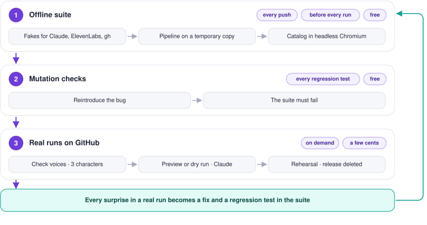

# Testing journal

How this project is tested, and a log of every real run, successful or not, with what it taught us. Each failure or surprise gets a fix and a regression test, so it cannot happen again silently.

## How testing works

Three layers, from cheapest to most realistic:

<p align="center">
  <picture>
    <source media="(prefers-color-scheme: dark)" srcset="assets/diagram-testing-dark.svg">
    
  </picture>
</p>

1. **Offline test suite** (`tests/`, pytest). Claude, ElevenLabs and `gh` are replaced by fakes; the pipeline runs on a temporary copy of the data; the catalog page runs in headless Chromium. Runs on every push (`tests.yml`) and before every generation, so a broken commit never produces an episode.
2. **Mutation checks**. To prove a test really protects against a bug, the bug is reintroduced in a scratch copy of the code and the suite must fail. Every regression test below was checked this way.
3. **Real runs on GitHub**, in increasing order of what they touch:
   - *Preview episode*: real script from Claude, published as a Preview card on the site; no audio, RSS feed untouched.
   - *Daily episode* with `dry_run`: real script, nothing published.
   - *Publication rehearsal*: real release upload and download, feed and catalog checked, release deleted; with `with_voice`, both ElevenLabs voices read two short sentences.

```
pip install -r requirements.txt -r requirements-dev.txt
python -m playwright install chromium   # for the catalog site tests
python -m pytest
```

## Test suite

| File | Tests | What it protects |
| --- | --- | --- |
| `test_validate.py` | 19 | Episode validation: headlines, themes and their order, sources, unspeakable characters (with the offending extract), first person, forbidden terms in spoken and published text, lengths |
| `test_generate.py` | 17 | The Claude loop: submission through the tool, light corrections versus corrections in the research conversation (no invented source), truncated responses, `pause_turn`, every tool call answered, workspace header, private context |
| `test_assemble.py` | 7 | Spoken script: fixed opening with AI disclosure, order of parts, sign-off by weekday, headline punctuation, the read layer always on the analyst voice |
| `test_tts.py` | 23 | ElevenLabs: chunking (long sentences split by words), request shape, voice settings, retries, one voice per part, context never crossing voices, pause in the same audio format as the voices, failures naming the voice, one-word voice check testing each voice independently, candidate IDs checked without changing the config, real duration kept when chunks are concatenated |
| `test_feed_catalog.py` | 5 | RSS feed (valid XML, escaping, enclosure, AI disclosure) and catalog (previews replaced by published episodes) |
| `test_main.py` | 13 | Every run mode end to end: dry run, preview, publication, force, weekend, failed speech keeps the preview and does not archive the script, voices checked before paying for the script |
| `test_publish.py` | 7 | `gh release` commands, public audio URL, Pages URL, download retries, Paris time |
| `test_rehearsal.py` | 9 | Rehearsal leaves nothing behind, release deleted even on failure, ElevenLabs key only for the voice check |
| `test_prompt.py` | 6 | Prompt and checks agree: an episode written exactly to the prompt passes |
| `test_cover.py` | 7 | Cover meets Spotify and Apple specs, deterministic, every word drawn even without the DejaVu font |
| `test_site.py` | 12 | Catalog page in a real browser: cards, Spotify button, search, theme filter, stats, deep links, HTML injection, mobile |
| `test_docs.py` | 11 | README and TESTING.md: images and paths exist, light and dark diagrams, workflow names, committed diagrams match their generator, the pipeline diagram names exactly the secrets the workflow uses, the episode diagram matches the prompt, the schedule diagram matches the crons and the code, **every text fits its box and nothing leaves the drawing** (measured in Chromium), the site screenshot can be regenerated |
| `test_schedule.py` | 9 | Every weekday of 2026 and 2027 (both daylight saving changes, every public holiday) publishes exactly once at 4:05 Paris time; the right cron each side of the change; a late start still recognised; the other cron stops before any cost; time left before a 7:00 listen |
| `test_repo.py` | 19 | Workflows (secrets, triggers, concurrency, dry-run guards, voice check only gets the ElevenLabs key), private files ignored, no forbidden term in tracked files, config ready to publish, this journal in sync with the suite |

## Journal of real runs

| Date | Run | Result | What happened | What changed |
| --- | --- | --- | --- | --- |
| 2026-10-14 | [Daily episode, dry run](https://github.com/GwendalYviquel/signal-in-the-ai-fog/actions/runs/38538992425) | ❌ | Claude API: *This API key is not scoped to a workspace* (HTTP 400) on the first call | Optional `ANTHROPIC_WORKSPACE_ID` secret sent as the `anthropic-workspace-id` header. Test: `test_workspace_header` |
| 2026-10-20 | [Preview](https://github.com/GwendalYviquel/signal-in-the-ai-fog/actions/runs/39441708741) | ❌ | Same workspace error: the key was still the same | Workspace ID secret added |
| 2026-10-20 | [Preview](https://github.com/GwendalYviquel/signal-in-the-ai-fog/actions/runs/39454278765) | ✅ | First real script, passed on the first attempt. Review found: headlines too long with commas, a sector-specific angle, ambiguous prices, stacked "as of" updates, episode about 7 minutes, "0 episodes" on the site | Six editorial fixes in the prompt and checks |
| 2026-10-20 | [Preview](https://github.com/GwendalYviquel/signal-in-the-ai-fog/actions/runs/39455278989) | ❌ | Attempt 1: free-text JSON was malformed (unescaped quotes). Attempt 2: brackets in facts, and the error did not say which | Episode submitted through the `submit_episode` tool (well-formed JSON guaranteed); errors quote the offending extract. Tests: `test_episode_is_submitted_through_the_tool_not_as_text`, `test_unspeakable_characters_are_rejected_with_the_extract` |
| 2026-10-20 | [Preview](https://github.com/GwendalYviquel/signal-in-the-ai-fog/actions/runs/39455788344) | ✅ (3rd attempt) | Attempt 1 cut off at 8000 output tokens (missing fields); attempt 2 rejected for the comma in "1,000" in a headline | `max_tokens` 16000; truncation reported as such; numbers without separators in headlines. Tests: `test_max_tokens_leaves_room_for_the_episode`, `test_truncated_response_is_named_as_such`, `test_headline_numbers_must_be_spelled_out` |
| 2026-10-20 | [Preview](https://github.com/GwendalYviquel/signal-in-the-ai-fog/actions/runs/39457365897) | ✅ (3rd attempt) | Headlines rejected twice: a comma, then 9 words once a number was spelled out. Each correction replayed every search result, about 3x the cost | Light corrections (episode and errors only, no web search); fixes needing new content go back to research so no source is invented; headlines up to 10 words with the count in the error. Tests: `test_wording_errors_are_fixed_in_a_light_correction`, `test_missing_source_goes_back_to_the_research_conversation`, `test_failed_light_correction_resumes_the_research_conversation` |
| 2026-10-20 | [Preview](https://github.com/GwendalYviquel/signal-in-the-ai-fog/actions/runs/39458009029) | ✅ (1st attempt) | 873 words for a target of 880. Ran on the previous commit: the push had been rejected because the previous preview's bot commit was on `main` | Always `git pull --rebase` before pushing |
| 2026-10-20 | [Daily episode, dry run](https://github.com/GwendalYviquel/signal-in-the-ai-fog/actions/runs/39458351634) | ✅ (1st attempt) | Tests then generation in the daily workflow; publication steps skipped as expected | — |
| 2026-10-20 | [Publication rehearsal](https://github.com/GwendalYviquel/signal-in-the-ai-fog/actions/runs/39460386881) | ✅ | Silent MP3 uploaded as a release with `gh`, downloaded back from its public URL, feed and catalog valid, release and tag deleted | — |
| 2026-10-20 | [Rehearsal with voices](https://github.com/GwendalYviquel/signal-in-the-ai-fog/actions/runs/39488426877) | ❌ | ElevenLabs HTTP 400: *You need to be on the creator tier or above to use this voice* (first host voice). The key itself was accepted | Host voice changed |
| 2026-10-20 | [Rehearsal with voices](https://github.com/GwendalYviquel/signal-in-the-ai-fog/actions/runs/39489527571) | ❌ | ElevenLabs HTTP 402: *Free users cannot use library voices via the API*. First read as a failure of the new host voice; the ElevenLabs dashboard showed 62 credits used, exactly the host sentence: the host voice worked and the **analyst** voice failed. The log could not tell which voice had failed | Every ElevenLabs request is logged (role, voice, characters), and a failure names the voice and what was already billed. Test: `test_failure_names_the_voice_and_what_was_already_billed`. Open: an analyst voice usable on the free plan, or a paid plan |

| 2026-10-20 | [Rehearsal with voices](https://github.com/GwendalYviquel/signal-in-the-ai-fog/actions/runs/39490313144) | ❌ | New analyst voice: also a library voice, HTTP 402. Thanks to the new log, identified at once: `request 2, analyst voice`. But the host sentence was billed again (62 credits) just to reach the analyst voice | One-word voice check (`Hi.`, 3 characters per voice, each voice tested independently): *Check voices* workflow, run on every change of `config.yaml`, and before every real publication so a broken voice stops the run before Claude is paid. Tests: `test_voice_check_costs_one_word_per_voice_and_tests_each_independently`, `test_voices_are_checked_before_paying_for_the_script` |

| 2026-10-20 | [Check voices](https://github.com/GwendalYviquel/signal-in-the-ai-fog/actions/runs/39490668885) | ❌ (expected) | First one-word check: host voice ok, analyst voice HTTP 402. 3 characters billed instead of 62 | — |
| 2026-10-20 | [Check voices, candidate ID](https://github.com/GwendalYviquel/signal-in-the-ai-fog/actions/runs/39490818034) | ✅ | Candidate analyst voice checked without changing the config: ok, 3 characters | Adopted as the analyst voice |

| 2026-10-20 | [Check voices on push](https://github.com/GwendalYviquel/signal-in-the-ai-fog/actions) | ✅ | Automatic check after the analyst voice changed in `config.yaml`: both voices ok, 6 characters | — |
| 2026-10-20 | [Rehearsal with voices](https://github.com/GwendalYviquel/signal-in-the-ai-fog/actions/runs/39497411738) | ✅ but a bug found | Both voices, 147 characters, mono 44.1 kHz, release uploaded, downloaded and deleted. The log said 3.6 s for two sentences: the sample really lasts 9.7 s (370 frames). Each ElevenLabs response starts with an Info header giving its own duration; concatenated, the first one made tools and players read the first chunk's duration. A real episode would have shown a few seconds on Spotify and a wrong seek bar | Info headers and ID3 tags stripped from every chunk; durations computed by counting frames; the rehearsal fails if players would read a duration off by more than 0.5 s. Tests: `test_concatenated_chunks_keep_their_real_duration`, `test_header_frames_are_not_counted_as_sound`, `test_response_without_audio_fails_clearly` |

The offline suite has also passed on GitHub for every commit since it was added.

## Bugs found by writing tests (before any real run hit them)

| Bug | Would have caused | Test |
| --- | --- | --- |
| Preview script deleted before speech synthesis | A failed ElevenLabs call lost the preview's script | `test_failed_speech_keeps_the_preview` |
| Script archived as aired before speech synthesis | After a failure, the next episode would assume it had been broadcast | same |
| A sentence over the chunk size sent whole | ElevenLabs rejects the request | `test_sentence_longer_than_the_limit_is_split_by_words` |
| A truncated tool call left unanswered | The API rejects the next request | `test_truncated_response_is_named_as_such` (the fake client enforces the rule) |
| Headline ending with a period | Spoken as "...and C.." | `test_headline_punctuation_is_not_doubled` |
| Stereo silence between mono voices | Clicks at each change of voice on some players | `test_pause_between_voice_turns_matches_the_audio_format` |
| Deep link to an episode never highlighted | Shared links did not show which episode | `test_deep_link_highlights_and_shows_the_episode` |
| Cover generated without DejaVu font | A cover with no text at all, silently | `test_without_dejavu_the_text_is_still_drawn` |

## Not covered yet

- A real episode end to end, with ElevenLabs: blocked by the analyst voice, a library voice that the free ElevenLabs plan cannot use through the API (see the last journal entry).
