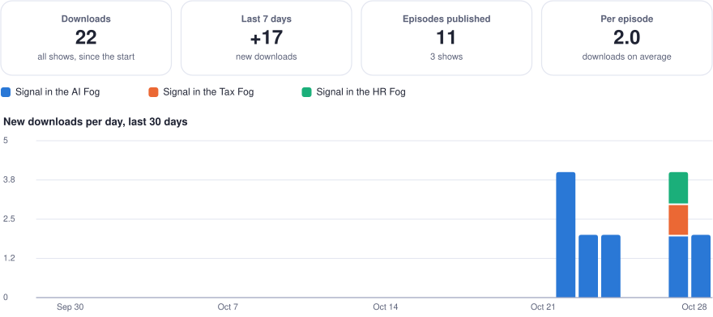

# Usage, all shows

Listening only, no money: costs are in [COSTS.md](COSTS.md). Generated by `engine/overview.py` with the daily stats: do not edit by hand. Each show's own report, episode by episode, is linked from its name.

  <picture>
    <source media="(prefers-color-scheme: dark)" srcset="usage-dashboard-dark.svg">
    
  </picture>

Downloads of each episode's MP3: the catalog site's player, podcast apps reading the RSS feed, and Spotify's single copy of the file. Spotify plays are not available through an API: they are in Spotify for Creators only.

| Show | Episodes published | Downloads | Last 7 days | Per episode | Snapshot |
| --- | ---: | ---: | ---: | ---: | --- |
| [Signal in the AI Fog](signal-in-the-ai-fog/STATS.md) | 4 | 11 | +11 | 2.8 | 2026-10-23 |
| [Signal in the Tax Fog](accounting-news-fr/STATS.md) | 1 | 1 | +1 | 1.0 | 2026-10-23 |
| [Signal in the HR Fog](hr-news-fr/STATS.md) | 1 | 2 | +2 | 2.0 | 2026-10-23 |
