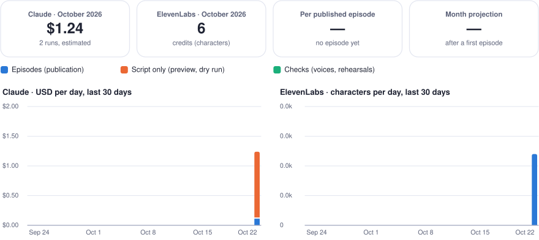

# Costs

What every run consumed, Claude and ElevenLabs. Generated by `engine/costs.py` from `data/costs.json` after each run: do not edit by hand.

  <picture>
    <source media="(prefers-color-scheme: dark)" srcset="finops-dashboard-dark.svg">
    
  </picture>

Claude estimates use the prices in `config.yaml` (claude-sonnet-5-5: $2.00 per million input tokens, $10.00 output, $2.50 cache write, $0.20 cache read, $10.00 per 1,000 web searches). ElevenLabs counts characters, which are its credits with the model used.

## By month

| Month | Runs | Episodes published | Claude tokens | Web searches | Claude (≈ USD) | ElevenLabs characters |
| --- | ---: | ---: | ---: | ---: | ---: | ---: |
| 2026-10 | 2 | 0 | 982,537 | 15 | $1.24 | 6 |

## Runs

| Date (UTC) | Mode | Outcome | Claude calls | Input tokens | Output tokens | Web searches | Claude (≈ USD) | ElevenLabs characters | Note |
| --- | --- | --- | ---: | ---: | ---: | ---: | ---: | ---: | --- |
| [2026-10-22 20:14](https://github.com/GwendalYviquel/signal-in-the-ai-fog/actions/runs/39845691066) | publish | failed | 1 | 17,951 | 7,730 | 0 | $0.13 | 6 | voice check 6 + episode 0 characters |
| [2026-10-22 18:55](https://github.com/GwendalYviquel/signal-in-the-ai-fog/actions/runs/39833139079) | preview | ok | 4 | 906,835 | 50,021 | 15 | $1.11 | 0 |  |
