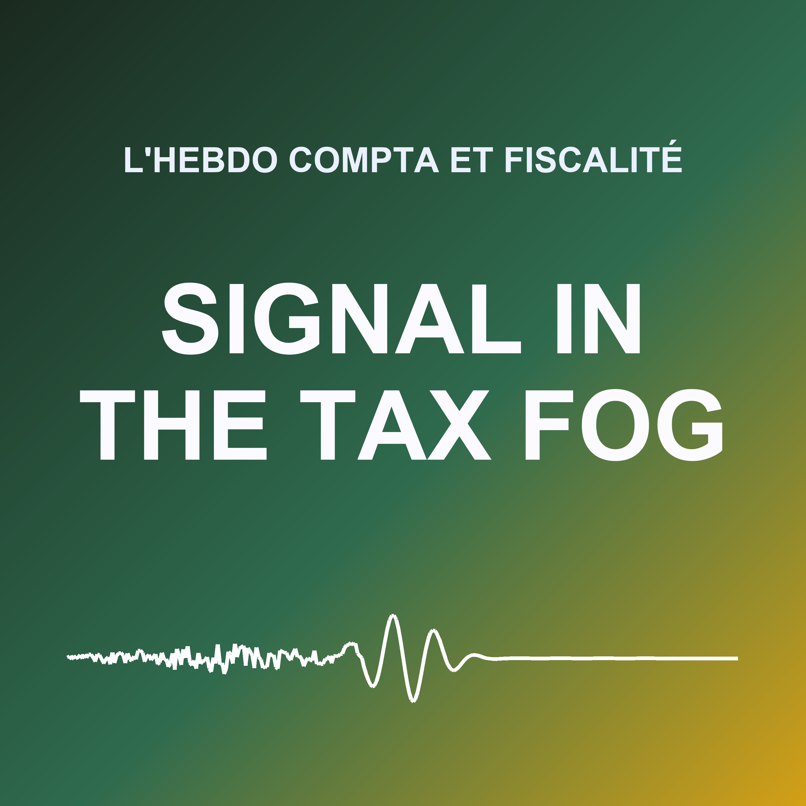

# Signal in the Tax Fog

**L'actualité comptable et fiscale de la semaine**: a weekly show in French for chartered accountants, finance departments and statutory auditors.

| | |
| --- | --- |
| Status | live: first episode on October 22, 2026, then every Monday |
| Language | French |
| Cadence | weekly, on Monday at 4:05 Paris time, with the news of the last seven days, weekend included |
| Length | about 10 minutes (`target_words: 1400`) |
| Writing | two steps (`generation.dossier`): a research dossier where every fact is quoted from its page and checked by the code, then the episode written from it alone; fact-check and light corrections on Claude Haiku |
| Voices | Anaïs (host: French news and podcasts) and Nicolas (analyst: French news, deep and steady), ElevenLabs library voices, chosen on October 22, 2026 from their descriptions and accepted by *Check voices* |
| Site | [catalog](https://gwendalyviquel.github.io/signal-in-the-ai-fog/accounting-news-fr/), in `docs/accounting-news-fr/` |
| Feed | `docs/accounting-news-fr/feed.xml`, on [Spotify](https://open.spotify.com/show/3I7wKK8IXhtqvsTzvXEeBt) since October 22, 2026 |
| Reports | [COSTS.md](COSTS.md) |

## Editorial line

Tax, accounting and audit news, read for practitioners: what changes, from which financial year, and what to prepare. Every text is given at its real stage (bill, vote, law, BOFiP commentary, decree), primary sources first (Légifrance, BOFiP, ANC, EUR-Lex). Never individual tax advice. Priorities: **e-commerce** (distance-selling VAT, OSS and IOSS, marketplaces, DAC7, small parcels) and **European rules** (VAT in the digital age, DAC8 and DAC9, customs reform). The full line, in French, is in [prompt.md](prompt.md).

Themes, in segment order (`show.yaml`): Fiscalité, E-commerce, Europe, Facturation électronique, Normes comptables, Durabilité, Audit. An episode has at most five segments, on the themes with news that week.

## Live

First episode published on Thursday, October 22, 2026 (forced, to start the feed); scheduled every Monday since. On [Spotify](https://open.spotify.com/show/3I7wKK8IXhtqvsTzvXEeBt). A private editorial context can be added at any time in the `EDITORIAL_CONTEXT_ACCOUNTING_NEWS_FR` secret.

Previews so far (October 22, 2026): about $1 to $2 of Claude each, with the two-step writing.
