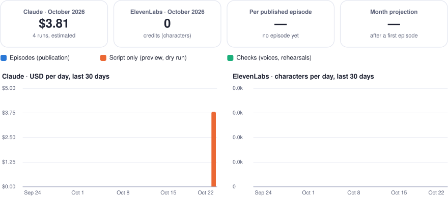

# Costs

What every run consumed, Claude and ElevenLabs. Generated by `engine/costs.py` from `data/costs.json` after each run: do not edit by hand.

  <picture>
    <source media="(prefers-color-scheme: dark)" srcset="finops-dashboard-dark.svg">
    
  </picture>

Claude estimates use the prices in `config.yaml` (claude-sonnet-5-5: $2.00 per million input tokens, $10.00 output, $2.50 cache write, $0.20 cache read, $10.00 per 1,000 web searches). ElevenLabs counts characters, which are its credits with the model used.

## By month

| Month | Runs | Episodes published | Claude tokens | Web searches | Claude (≈ USD) | ElevenLabs characters |
| --- | ---: | ---: | ---: | ---: | ---: | ---: |
| 2026-10 | 5 | 0 | 3,504,413 | 45 | $3.81 | 12 |

## Runs

| Date (UTC) | Mode | Outcome | Claude calls | Input tokens | Output tokens | Web searches | Claude (≈ USD) | ElevenLabs characters | Note |
| --- | --- | --- | ---: | ---: | ---: | ---: | ---: | ---: | --- |
| [2026-10-22 19:58](https://github.com/GwendalYviquel/signal-in-the-ai-fog/actions/runs/39844667375) | voice check | ok | — | — | — | — | — | 12 | candidates: mlIQEcTmPRMIHZApujDD,zNijNwkR2nhHrbrmJITT,5OnMHwgTFgvPVwE8jP6B,iCKVfVbyCo5AAswzTkkX |
| [2026-10-22 19:22](https://github.com/GwendalYviquel/signal-in-the-ai-fog/actions/runs/39837697803) | preview | ok | 5 | 2,288,352 | 94,826 | 15 | $1.96 | 0 |  |
| [2026-10-22 19:06](https://github.com/GwendalYviquel/signal-in-the-ai-fog/actions/runs/39836788476) | preview | failed | 3 | 50,554 | 19,356 | 0 | $0.28 | 0 |  |
| [2026-10-22 18:46](https://github.com/GwendalYviquel/signal-in-the-ai-fog/actions/runs/39833133296) | preview | ok | 4 | 726,059 | 41,647 | 15 | $0.96 | 0 |  |
| [2026-10-22 17:04](https://github.com/GwendalYviquel/signal-in-the-ai-fog/actions/runs/39818409657) | preview | failed | 3 | 255,116 | 28,503 | 15 | $0.61 | 0 |  |
