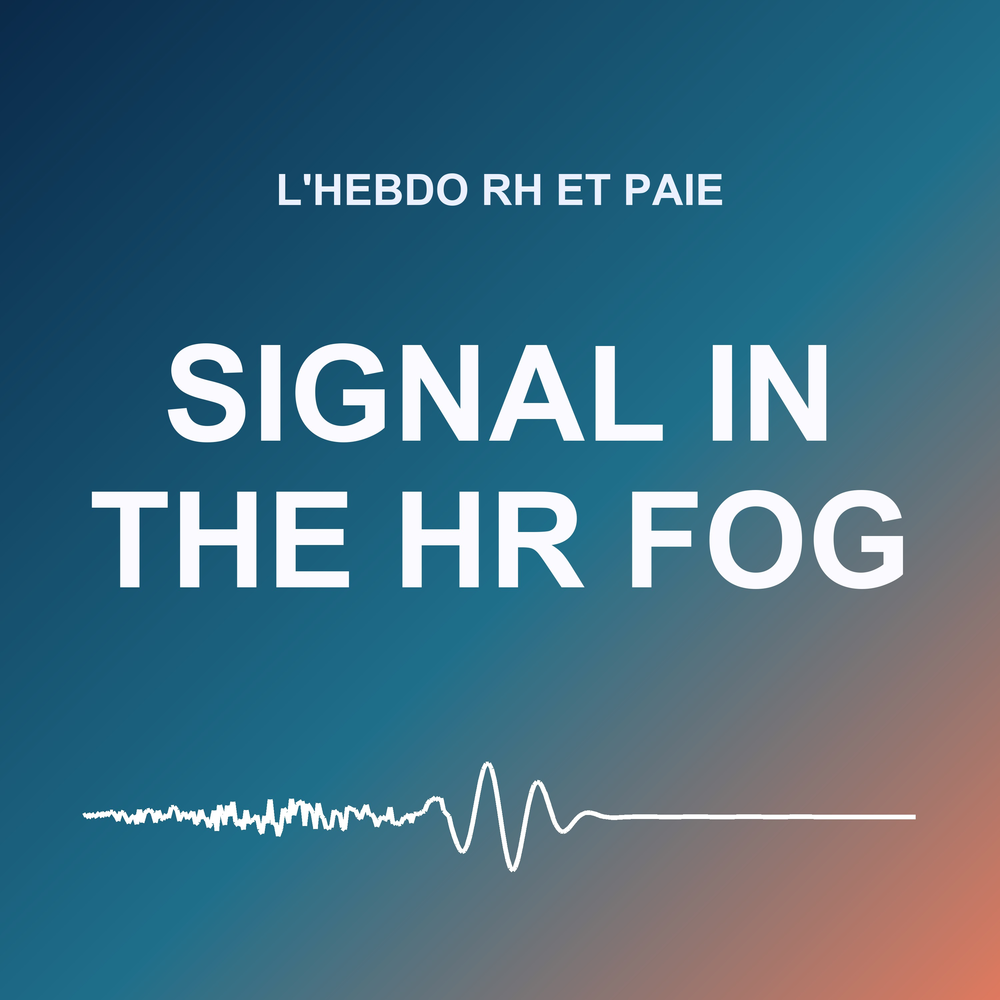

# Signal in the HR Fog

**L'actualité RH et paie de la semaine**: a weekly show in French for HR managers and payroll teams.

| | |
| --- | --- |
| Status | scheduled: first episode on Monday, October 26, 2026 |
| Language | French |
| Cadence | weekly, on Monday at 4:05 Paris time, with the news of the last seven days, weekend included |
| Length | about 10 minutes (`target_words: 1400`) |
| Writing | two steps (`generation.dossier`): a research dossier where every fact is quoted from its page and checked by the code, then the episode written from it alone; fact-check and light corrections on Claude Haiku |
| Voices | Geneviève (host: a French news anchor) and Pierre (analyst: a French editorial narrator), ElevenLabs library voices, chosen on October 22, 2026 from their descriptions and accepted by *Check voices* |
| Site | [catalog](https://gwendalyviquel.github.io/signal-in-the-ai-fog/hr-news-fr/), in `docs/hr-news-fr/` |
| Feed | `docs/hr-news-fr/feed.xml`, to submit to Spotify once after the first episode |
| Reports | [COSTS.md](COSTS.md) |

## Editorial line

Labour law, payroll and social news, read for practitioners: what changes, from when, and what to check. Every text is given at its real stage (bill, law, decree, case law), primary sources first (Légifrance, BOSS, URSSAF, Cour de cassation). Never individual legal advice; angles stay generic ("pour un service paie", "pour une entreprise de cinquante salariés"). The full line, in French, is in [prompt.md](prompt.md).

Themes, in segment order (`show.yaml`): Droit du travail, Paie et cotisations, IA et travail, Santé et conditions de travail, Emploi et retraite, Dialogue social, Formation, Europe. An episode has at most five segments, on the themes with news that week.

## Going live

Scheduled since October 22, 2026: the first episode comes out on Monday, October 26, at 4:05 Paris time. Then submit its feed to Spotify once, by hand, and set `podcast.spotify_url`. A private editorial context can be added at any time in the `EDITORIAL_CONTEXT_HR_NEWS_FR` secret.

Previews so far (October 22, 2026): about $1 to $2 of Claude each, with the two-step writing.
